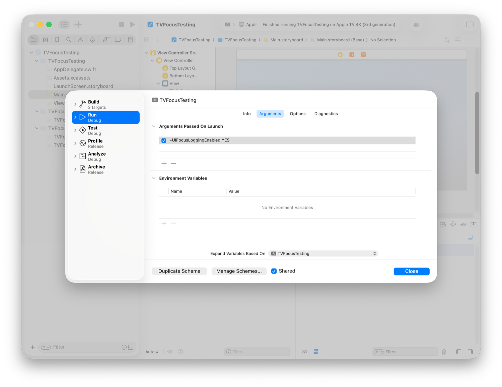
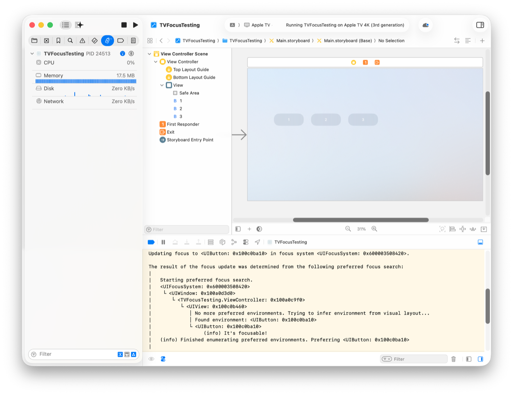

> 导航：[Technologies](../technologies.md) · [UIKit](../uikit.md) · [Focus-based navigation](focus-based-navigation.md)

# 调试 App 中的焦点问题

文章

查找错误并确定下一个聚焦项不是你所期望的原因。

## 概述

对于使用 tvOS App 的间接控制，焦点必须正常工作。为帮助你查找焦点问题，Apple 提供了两个调试工具：`UIFocusLoggingEnabled` 和 [UIFocusDebugger](uifocusdebugger.md)。

### 开启实时焦点日志

通过开启实时焦点日志，了解焦点引擎如何确定当前哪个视图处于焦点。当你移动焦点时，日志会更新，显示新视图如何获得焦点。

在 Xcode 项目中，选择 Edit Scheme，并在 Arguments Passed On Launch 部分添加 `-UIFocusLoggingEnabled YES`。

启动时，调试器会记录所有焦点事件，并在 Xcode 控制台和「控制台」App 中显示这些事件。随着 App 中焦点的变化，调试器会更新日志。

### 使用 UIFocusDebugger 查找焦点问题

[UIFocusDebugger](uifocusdebugger.md) 类包含多个帮助查找焦点问题的方法。你不会直接在代码中使用这个类或其方法。相反，在调试会话期间，你从 LLDB 调试器命令行调用该类的方法，以获取焦点系统状态的信息。例如，`po UIFocusDebugger.status()` 返回焦点引擎的状态。

## 另请参阅

### 焦点调试

- [UIFocusDebugger](uifocusdebugger.md) — 用于调试焦点相关交互的运行时对象。
