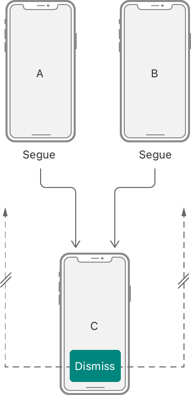
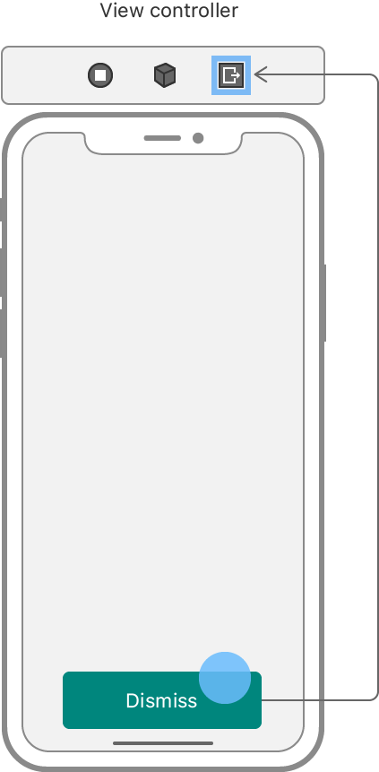

> 导航：[Technologies](../technologies.md) · [UIKit](../uikit.md) · [Resource management](resource-management.md)

# 使用 unwind segue 关闭视图控制器

<sub>文章</sub>

在你的 storyboard 文件中配置 unwind segue，动态选择下一个要显示的最合适视图控制器。

## 概述

要处理视图控制器的关闭，请创建一个 unwind segue。与你用于呈现视图控制器的 segue 不同，unwind segue 承诺关闭当前视图控制器，但不承诺过渡结果的具体目标。相反，UIKit 在运行时以编程方式确定 unwind segue 的目标。

UIKit 在运行时确定 unwind segue 的目标，因此你在设置视图控制器层级时不受限制。考虑一个场景：两个视图控制器都呈现同一个子视图控制器，如下图所示。你可以添加复杂逻辑来确定接下来显示哪个视图控制器，但这种解决方案扩展性不好。相反，UIKit 提供了一个简单的编程解决方案，只需极少努力即可扩展到任意数量的视图控制器。



<sub>一张插图，展示把 unwind segue 连接到特定视图控制器的问题。可能有多个目标可供选择。</sub>

### 在父视图控制器上定义 unwind 动作

unwind segue 动作方法的存在告诉 UIKit，某个视图控制器是 unwind segue 的潜在目标。在 storyboard 中配置任何 unwind segue 之前，把此动作方法添加到至少一个视图控制器中。如果没有视图控制器具有 unwind 动作，Xcode 会阻止你创建 unwind segue。此动作方法具有以下格式：

**Swift**

```swift
@IBAction func myUnwindAction(unwindSegue: UIStoryboardSegue)
```

**Objective-C**

```objc
- (IBAction) myUnwindAction:(UIStoryboardSegue*)unwindSegue
```

你不需要在 unwind segue 动作方法中做任何事。方法的存在就足以关闭当前视图控制器。不过，你可以使用该方法在关闭过程中执行相关任务。例如，你可能把数据从被关闭的视图控制器传回呈现它的父视图控制器。如果是这样，你可以使用提供的 [UIStoryboardSegue](uistoryboardsegue.md) 对象来检索起始和结束视图控制器。

### 把触发对象连接到 Exit 控件

在你的 storyboard 中，通过右键单击触发对象并拖动到视图控制器场景顶部的 Exit 控件来创建 unwind segue。你可以从任何支持 target-action 设计模式的对象触发 segue，例如附加到视图控制器的控制或手势识别器。



当你把对象连接到 Exit 控件时，UIKit 会呈现已知动作方法的列表。选择其中一个动作方法以完成 unwind segue。你只选择动作方法，而不选择特定的视图控制器。要在关闭后显示，父视图控制器必须实现你所选的方法。

当用户触发关闭动作时，UIKit 在当前视图控制器层级中搜索实现了指定动作方法的视图控制器。它从直接父视图控制器开始查找最近的视图控制器，并向上遍历视图控制器层级，直到找到合适的目标。如果找不到实现了该方法的视图控制器，unwind segue 会静默失败，当前视图控制器保持在屏幕上。

## 另请参阅

### Storyboards

- [Customizing the behavior of segue-based presentations](customizing-the-behavior-of-segue-based-presentations.md) — 在 segue 期间在视图控制器之间传递数据，并以编程方式控制 segue 何时发生。
- [UIStoryboard](uistoryboard.md) — 对 Interface Builder storyboard 资源文件中设计时视图控制器图的封装。
- [UIStoryboardSegue](uistoryboardsegue.md) — 一个为两个视图控制器之间的视觉过渡做准备并执行该过渡的对象。
- [UIStoryboardUnwindSegueSource](uistoryboardunwindseguesource.md) — 对 unwind segue 信息的封装。
