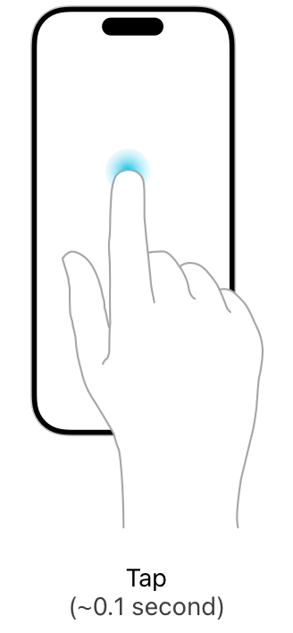

> 导航：[Technologies](../technologies.md) · [UIKit](../uikit.md) · [Touches, presses, and gestures](touches-presses-and-gestures.md) · [Handling UIKit gestures](handling-uikit-gestures.md)

# 处理轻点手势

<sub>文章</sub>

使用屏幕上短暂的轻点来实现类似按钮的与内容交互。

## 概述

轻点手势检测一个或多个手指短暂触摸屏幕。这些手势涉及的手指必须不会从初始触点显著移动，你可以配置手指必须触摸屏幕的次数。例如，你可能配置轻点手势识别器来检测单次轻点、双击或三击。

你可以通过以下方式之一附加手势识别器：

- 以编程方式。调用视图的 [- addGestureRecognizer:](<uiview/addgesturerecognizer(__).md>) 方法。
- 在 Interface Builder 中。从库中拖动合适的对象并将其放到视图上。



[UITapGestureRecognizer](uitapgesturerecognizer.md) 对象提供与按钮类似的功能——它检测其视图中的轻点，并把该轻点报告给你的动作方法。轻点手势是离散的，因此你的动作方法仅在轻点手势成功识别时被调用。你可以配置轻点手势识别器要求任意次数的轻点——例如，单击或双击——然后才调用你的动作方法。

以下代码展示了一个响应视图中成功轻点的动作方法，它把该视图动画移动到新位置。即使对于离散手势识别器，在执行任何动作之前也应始终检查手势识别器的 [state](uigesturerecognizer/state-swift.property.md) 属性。

```swift
@IBAction func tapPiece(_ gestureRecognizer: UITapGestureRecognizer) {
   guard gestureRecognizer.view != nil else { return }
        
   if gestureRecognizer.state == .ended {      // Move the view down and to the right when tapped.
      let animator = UIViewPropertyAnimator(duration: 0.2, curve: .easeInOut, animations: {
         gestureRecognizer.view!.center.x += 100
         gestureRecognizer.view!.center.y += 100
      })
      animator.startAnimation()
   }
}
```

如果你的轻点手势识别器代码没有被调用，请检查以下条件是否为真，并按需修正：

- 视图的 [userInteractionEnabled](uiview/isuserinteractionenabled.md) 属性设为 [true](../swift/true.md)。图像视图和标签默认把此属性设为 [false](../swift/false.md)。
- 轻点次数等于 [numberOfTapsRequired](uitapgesturerecognizer/numberoftapsrequired.md) 属性中指定的次数。
- 手指数量等于 [numberOfTouchesRequired](uitapgesturerecognizer/numberoftouchesrequired.md) 属性中指定的次数。

## 另请参阅

### 手势

- [Handling long-press gestures](handling-long-press-gestures.md) — 检测屏幕上持续时间较长的轻点，并用它们显示与上下文相关的额外内容。
- [Handling pan gestures](handling-pan-gestures.md) — 跟踪手指在屏幕上的移动，并把该移动应用到你的内容。
- [Handling swipe gestures](handling-swipe-gestures.md) — 检测屏幕上的水平或垂直滑动动作，并用它触发内容的导航。
- [Handling pinch gestures](handling-pinch-gestures.md) — 跟踪两指之间的距离，并用该信息缩放或缩放你的内容。
- [Handling rotation gestures](handling-rotation-gestures.md) — 测量屏幕上两指的相对旋转，并用该动作旋转你的内容。
