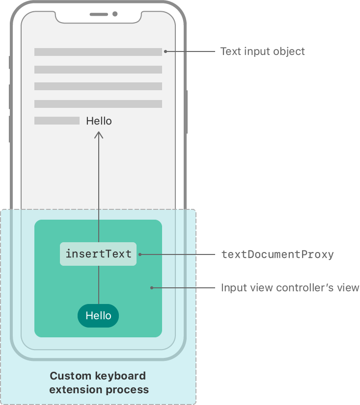
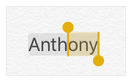

> 导航： [Technologies](../technologies.md) · [UIKit](../uikit.md) · [Keyboards and input](keyboards-and-input.md) · [Creating a custom keyboard](creating-a-custom-keyboard.md)

# 处理自定键盘中的文本交互

<sub>文章</sub>

使用代理访问文本输入视图，插入、删除并操纵文本。

## 概述

自定键盘在独立进程中运行，无法直接访问用户正在编辑的文本。代理对象 [UITextDocumentProxy](uitextdocumentproxy.md) 提供对输入文本视图的访问。通过文本文档代理，你可以插入或删除文本、操纵插入点，并访问插入点周围的额外文本上下文。



<sub>图示显示自定键盘扩展进程与文本输入对象的关系。在键盘扩展进程中，输入视图控制器使用文本文档代理将字符串插入文本输入视图。</sub>

### 插入与删除文本

文本文档代理遵循 [UIKeyInput](uikeyinput.md) 协议，提供用于插入与删除文本的方法。要向当前输入视图插入字符或字符串：

```swift
textDocumentProxy.insertText("Hello world.")
```

要删除当前插入点前的字符：

```swift
textDocumentProxy.deleteBackward()
```

你可以使用 [hasText](uikeyinput/hastext.md) 属性确定输入视图是否包含任何文本：

```swift
if textDocumentProxy.hasText {
    // Do something with the text
}

```

### 调整插入点

要移动文本输入视图中的插入点，使用 [- adjustTextPositionByCharacterOffset:](<uitextdocumentproxy/adjusttextposition(bycharacteroffset_).md>) 方法。例如，如果你想实现向前删除操作，先将插入位置向前移动一个字符，再向后删除：

```swift
// Move the text insertion position forward 1 character
textDocumentProxy.adjustTextPosition(byCharacterOffset: 1)

// Delete the previous character
textDocumentProxy.deleteBackward()
```

你可能希望仅当插入点不在正在输入文本的末尾时才启用此功能，方法是检查插入点之后的上下文。更多详情请参阅 [Get context around the insertion point](handling-text-interactions-in-custom-keyboards.md#Get-context-around-the-insertion-point)。

### 用户编辑时响应更改

当你的键盘处于活动状态时，用户可能会执行更改文本或选区的操作。你的自定键盘控制器——一个遵循 [UITextInputDelegate](uitextinputdelegate.md) 协议的 [UIInputViewController](uiinputviewcontroller.md) 子类——可以自动获知这些文本与选区更改。你可以重写该委托协议中的两组方法来接收这些通知。第一组在文本更改时调用，第二组在选区更改时调用。因为你的键盘扩展无法直接访问文本输入字段，参数为 `nil`。

```swift
func textWillChange(_ textInput: UITextInput?)
func textDidChange(_ textInput: UITextInput?)

func selectionWillChange(_ textInput: UITextInput?)
func selectionDidChange(_ textInput: UITextInput?)
```

### 获取插入点周围的上下文

要执行自动完成或自动大写等某些操作，你可能需要正在输入文本周围的额外上下文。你可以按如下方式访问插入点之前与之后的上下文：

```swift
let precedingText = textDocumentProxy.documentContextBeforeInput ?? ""
let followingText = textDocumentProxy.documentContextAfterInput ?? ""
let selectedText = textDocumentProxy.selectedText ?? ""
let fullText = "\(precedingText)\(selectedText)\(followingText)"
```

使用 [CFStringTokenizer](../corefoundation/cfstringtokenizer.md) 通过将周围文本（或组合文本）拆分为单词、段落或句子来更好地理解上下文。此信息使你能够实现自动大写。

1. 调用 [documentContextBeforeInput](uitextdocumentproxy/documentcontextbeforeinput.md) 获取插入点前的文本。
2. 使用 [CFStringTokenizer](../corefoundation/cfstringtokenizer.md) 定位当前单词的开头。
3. 将插入点移动到单词第一个字符之后。
4. 调用 [- deleteBackward](<uikeyinput/deletebackward().md>)。
5. 调用 [- insertText:](<uikeyinput/inserttext(__).md>) 并传入适当的带大写字母。
6. 将插入点移回其原始位置。

### 用户编辑时标记文本

某些文本输入操作需要多次操作才能完成单个字符或单词。例如，你的键盘可能支持一种需要多次按键才能组成单个字符的语言。[UITextDocumentProxy](uitextdocumentproxy.md) 允许你插入文本并标记其中部分或全部，供后续编辑操作使用。以下代码展示如何使用 [- setMarkedText:selectedRange:](<uitextdocumentproxy/setmarkedtext(__selectedrange_).md>) 将组合重音字符作为标记文本插入：

```swift
let accentCharacter = " \u{0301}"
let range = NSRange(location: 0, length: accentCharacter.count)
textDocumentProxy.setMarkedText(accentCharacter, selectedRange: range)
```

调用 `setMarkedText` 会选择 `range` 指定的文本。后续插入会替换该范围内选中的字符。在上面的示例中，显示的是一个带有组合尖锐重音的空格。如果用户接下来输入的字符是 `a`，你可以随后插入组合后的 `á`。

```swift
textDocumentProxy.insertText("a\u{0301}")
```

如果传给 [- setMarkedText:selectedRange:](<uitextdocumentproxy/setmarkedtext(__selectedrange_).md>) 的范围仅覆盖传入字符串的一部分，则未选中的部分会以背景颜色标记。你可以利用这一点来显示自动完成内容。例如，如果你支持名称的自动完成，且用户已输入 "Anth"，你可能会显示 "Anthony" 作为自动完成：

```swift
let text = "Anthony"
let range = NSRange(location: 4, length: 3)
textDocumentProxy.setMarkedText(text, selectedRange: range)
```

上面的代码会显示为：



<sub>截图显示标记文本。单词开头被标记，表示它正在被自动完成；单词末尾被选中，表示后续按键将替换文本的该部分。</sub>

随着用户继续输入，你可以通过后续调用 [- setMarkedText:selectedRange:](<uitextdocumentproxy/setmarkedtext(__selectedrange_).md>) 更新标记文本。

调用 [- unmarkText](<uitextdocumentproxy/unmarktext().md>) 可清除标记文本指示，文本保留在输入视图中。
