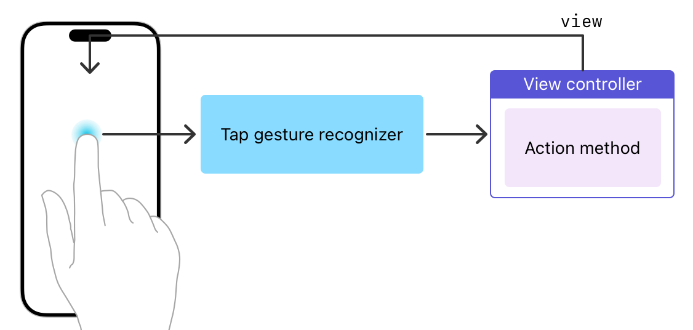

> 导航： [Technologies](../technologies.md) · [UIKit](../uikit.md) · [Touches, presses, and gestures](touches-presses-and-gestures.md)

# 处理 UIKit 手势

使用手势识别器简化触摸处理并创建一致的用户体验。

## 概述

手势识别器是处理视图中触摸或按压事件的最简单方式。你可以将一个或多个手势识别器附加到任何视图。手势识别器封装了处理和解释该视图传入事件并将其匹配到已知模式所需的所有逻辑。当检测到匹配时，手势识别器会通知其分配的目标对象，该对象可以是视图控制器、视图本身或 App 中的任何其他对象。

手势识别器使用目标-动作设计模式来发送通知。当 [UITapGestureRecognizer](uitapgesturerecognizer.md) 对象在视图中检测到单指轻点时，它会调用视图的视图控制器的 action 方法，你用它来提供响应。



手势识别器分为两种类型：离散和连续。_离散手势识别器_ 在手势被识别后恰好调用一次你的 action 方法。_连续手势识别器_ 在其初始识别条件满足后，会多次调用你的 action 方法，每当手势事件中的信息发生变化时通知你。例如，[UIPanGestureRecognizer](uipangesturerecognizer.md) 对象会在触摸位置每次更改时调用你的 action 方法。

Interface Builder 为每个标准 UIKit 手势识别器都包含对象。它还包含一个自定义手势识别器对象，你可以用它来表示你的自定义 [UIGestureRecognizer](uigesturerecognizer.md) 子类。

### 配置手势识别器

要配置手势识别器：

1. 在你的 storyboard 中，将手势识别器拖到你的视图上。
2. 实现一个在手势被识别时调用的 action 方法；参见以下代码。
3. 将你的 action 方法连接到手势识别器。

你可以在 Interface Builder 中通过右键点击手势识别器并将其 Sent Action 选择器连接到界面中的适当对象来创建此连接。你也可以使用手势识别器的 [- addTarget:action:](<uigesturerecognizer/addtarget(__action_).md>) 方法以编程方式配置 action 方法。

以下代码显示手势识别器 action 方法的通用格式。如果你愿意，可以将参数类型更改为匹配特定的手势识别器子类。

**Swift**

```swift
@IBAction func myActionMethod(_ sender: UIGestureRecognizer)
```

**Objective-C**

```objc
- (IBAction)myActionMethod:(UIGestureRecognizer*)sender
```

### 响应手势

与手势识别器关联的 action 方法提供你的 App 对该手势的响应。对于离散手势，你的 action 方法类似于按钮的 action 方法。一旦 action 方法被调用，你执行适合该手势的任何任务。对于连续手势，你的 action 方法可以响应手势的识别，但也可以在手势被识别之前跟踪事件。跟踪事件可以让你创建更具交互性的体验。例如，你可能使用 [UIPanGestureRecognizer](uipangesturerecognizer.md) 对象的更新来重新定位 App 中的内容。

手势识别器的 [state](uigesturerecognizer/state-swift.property.md) 属性传达对象当前的识别状态。对于连续手势，手势识别器会将此属性的值从 [UIGestureRecognizerStateBegan](uigesturerecognizer/state-swift.enum/began.md) 更新为 [UIGestureRecognizerStateChanged](uigesturerecognizer/state-swift.enum/changed.md)，再更新为 [UIGestureRecognizerStateEnded](uigesturerecognizer/state-swift.enum/ended.md)，或更新为 [UIGestureRecognizerStateCancelled](uigesturerecognizer/state-swift.enum/cancelled.md)。你的 action 方法使用此属性来确定适当的行动方案。例如，你可能使用 began 和 changed 状态对内容进行临时更改，使用 ended 状态使这些更改永久生效，并使用 cancelled 状态丢弃更改。在采取行动之前，始终检查手势识别器的 [state](uigesturerecognizer/state-swift.property.md) 属性的值。

有关如何处理特定类型手势的示例，参见以下信息：

- [Handling tap gestures](handling-tap-gestures.md)
- [Handling long-press gestures](handling-long-press-gestures.md)
- [Handling pan gestures](handling-pan-gestures.md)
- [Handling swipe gestures](handling-swipe-gestures.md)
- [Handling pinch gestures](handling-pinch-gestures.md)
- [Handling rotation gestures](handling-rotation-gestures.md)

有关手势识别器状态及其如何影响代码的更多信息，参见 [Implementing a custom gesture recognizer](implementing-a-custom-gesture-recognizer.md)。

## 主题

### Gestures

- [Handling tap gestures](handling-tap-gestures.md) — 使用屏幕上的短暂轻点来实现与内容的按钮式交互。
- [Handling long-press gestures](handling-long-press-gestures.md) — 检测屏幕上扩展时长的轻点，并使用它们揭示上下文相关的相关的内容。
- [Handling pan gestures](handling-pan-gestures.md) — 跟踪手指在屏幕上的移动，并将该移动应用到你的内容。
- [Handling swipe gestures](handling-swipe-gestures.md) — 检测屏幕上的水平或垂直滑动动作，并使用它来触发内容导航。
- [Handling pinch gestures](handling-pinch-gestures.md) — 跟踪两指之间的距离，并使用该信息来缩放或缩放你的内容。
- [Handling rotation gestures](handling-rotation-gestures.md) — 测量屏幕上两指的相对旋转，并使用该动作旋转你的内容。

## 另请参阅

### Standard gestures

- [Coordinating multiple gesture recognizers](coordinating-multiple-gesture-recognizers.md) — 了解如何在同一视图上使用多个手势识别器。
- [Adopting hover support for Apple Pencil](adopting-hover-support-for-apple-pencil.md) — 通过 Apple Pencil 输入的悬停预览，增强你的 iPadOS App 的用户反馈。
- [Supporting gesture interaction in your apps](supporting-gesture-interaction-in-your-apps.md) — 通过支持标准和自定义手势交互，丰富 App 的用户体验。
- [UIHoverGestureRecognizer](uihovergesturerecognizer.md) — 解释视图上指针移动的连续手势识别器。
- [UILongPressGestureRecognizer](uilongpressgesturerecognizer.md) — 解释长按手势的连续手势识别器。
- [UIPanGestureRecognizer](uipangesturerecognizer.md) — 解释平移手势的连续手势识别器。
- [UIPinchGestureRecognizer](uipinchgesturerecognizer.md) — 解释涉及两指触摸的捏合手势的连续手势识别器。
- [UIRotationGestureRecognizer](uirotationgesturerecognizer.md) — 解释涉及两指触摸的旋转手势的连续手势识别器。
- [UIScreenEdgePanGestureRecognizer](uiscreenedgepangesturerecognizer.md) — 解释从屏幕边缘附近开始的平移手势的连续手势识别器。
- [UISwipeGestureRecognizer](uiswipegesturerecognizer.md) — 解释一个或多个方向滑动手势的离散手势识别器。
- [UITapGestureRecognizer](uitapgesturerecognizer.md) — 解释单次或多次轻点的离散手势识别器。
