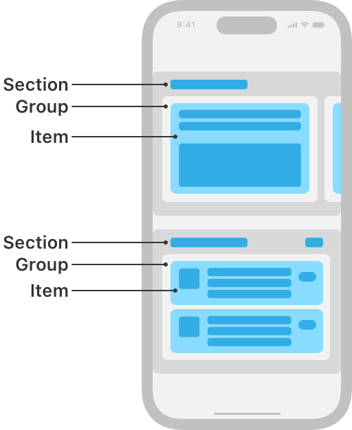

> 导航： [Technologies](../technologies.md) · [UIKit](../uikit.md) · [Views and controls](views-and-controls.md) · [Collection views](collection-views.md)

# 布局

API 集合

以高度可配置的布局安排你的集合视图内容。

## 概述

集合视图的_布局_定义了集合中内容的视觉排列。布局被设计为灵活的，以便你能为内容创建所需的任何排列，从简单到复杂。最简单的集合视图布局以网格形式显示其项目，但你可以定义布局来以任意方式安排项目。例如，你可能会创建一个布局，其中项目排列成圆形或大小各异。你还可以在运行时动态更改布局，以便在需要以不同方式呈现项目时使用，例如当用户旋转设备时。

集合视图布局是可自定且高度可视化的。例如，App Store App 使用单个集合视图，每个分区使用自定布局来展示不同类型的内容。

App Store App 在 iOS 上的示意图，显示一个带有组合式布局的集合视图。该布局由两个水平滚动的分区组成，它们有不同的布局。顶部分区显示一个组，屏幕上可见一个项目，其他组从屏幕两侧露出。底部分区显示一个组，该组是三格单元格的列，每个单元格都是一个项目。

有关设计指南，请参阅 [Human Interface Guidelines](https://developer.apple.com/design/human-interface-guidelines/ios/views/collections/)。

## 主题

### 基础

- [Implementing modern collection views](implementing-modern-collection-views.md) — 将组合式布局引入你的 App，并使用可差分数据源简化用户界面的更新。
- [UICollectionViewCompositionalLayout](uicollectionviewcompositionallayout.md) — 一个布局对象，允许你以高度自适应且灵活的视觉排列组合项目。

### 组件

- [NSCollectionLayoutItem](nscollectionlayoutitem.md) — 集合视图布局的最基本组件。
- [NSCollectionLayoutGroup](nscollectionlayoutgroup.md) — 一个容器，用于一组沿路径布局的项目。
- [NSCollectionLayoutSection](nscollectionlayoutsection.md) — 一个容器，将一组组组合成不同的视觉分组。

### 大小与间距

- [NSCollectionLayoutDimension](nscollectionlayoutdimension.md) — 表示集合视图中某个项目宽度或高度的单个维度。
- [NSCollectionLayoutSize](nscollectionlayoutsize.md) — 集合视图中某个项目的宽度与高度。
- [NSCollectionLayoutSpacing](nscollectionlayoutspacing.md) — 一个定义集合视图中项目之间或周围空间的对象。
- [NSCollectionLayoutEdgeSpacing](nscollectionlayoutedgespacing.md) — 一个定义项目边缘周围空间的对象。
- [NSCollectionLayoutContainer](nscollectionlayoutcontainer.md) — 一个用于提供布局容器的大小与内容内边距信息的协议。

### 配置

- [UICollectionViewCompositionalLayoutConfiguration](uicollectionviewcompositionallayoutconfiguration.md) — 一个定义布局滚动方向、分区间距以及页眉或页脚的对象。
- [UICollectionViewCompositionalLayoutSectionProvider](uicollectionviewcompositionallayoutsectionprovider.md) — 一个创建并返回布局每个分区的闭包。
- [NSCollectionLayoutEnvironment](nscollectionlayoutenvironment.md) — 一个用于提供布局容器与环境特性（如尺寸类别与显示缩放因子）信息的协议。

### 交互

- [UICollectionLayoutSectionOrthogonalScrollingBehavior](uicollectionlayoutsectionorthogonalscrollingbehavior.md) — 布局的分区相对于主布局轴的滚动行为。

### 外观

- [NSCollectionLayoutAnchor](nscollectionlayoutanchor.md) — 一个定义如何将补充项目附加到集合视图中某个项目的对象。
- [NSCollectionLayoutSupplementaryItem](nscollectionlayoutsupplementaryitem.md) — 一个用于向集合视图中的项目添加额外视觉装饰的对象。
- [NSCollectionLayoutBoundarySupplementaryItem](nscollectionlayoutboundarysupplementaryitem.md) — 一个用于向集合视图添加页眉或页脚的对象。
- [NSCollectionLayoutDecorationItem](nscollectionlayoutdecorationitem.md) — 一个用于向集合视图的某个分区添加背景的对象。

### 高级布局

- [NSCollectionLayoutGroupCustomItem](nscollectionlayoutgroupcustomitem.md) — 一个在具有自定布局排列的组中使用的项目。
- [NSCollectionLayoutGroupCustomItemProvider](nscollectionlayoutgroupcustomitemprovider.md) — 一个创建并返回自定组每个项目的闭包。

### 布局更新

- [NSCollectionLayoutVisibleItem](nscollectionlayoutvisibleitem.md) — 当前在某个分区内可见的项目。
- [NSCollectionLayoutSectionVisibleItemsInvalidationHandler](nscollectionlayoutsectionvisibleitemsinvalidationhandler.md) — 在每个布局周期之前调用的闭包，允许在项目显示前立即修改某个分区中的项目。
- [UICollectionViewUpdateItem](uicollectionviewupdateitem.md) — 一个描述对集合视图中某个项目进行单次更改的对象。
- [UICollectionViewFocusUpdateContext](uicollectionviewfocusupdatecontext.md) — 一个存储与集合视图中焦点更新相关信息的上下文对象。
- [UICollectionViewLayoutInvalidationContext](uicollectionviewlayoutinvalidationcontext.md) — 一个声明布局失效时需要更新布局哪些部分的上下文对象。

### 手动布局

- [Customizing collection view layouts](customizing-collection-view-layouts.md) — 通过更改流布局中单元格的大小或实现马赛克样式来自定集合视图布局。
- [UICollectionViewLayout](uicollectionviewlayout.md) — 一个用于为集合视图生成布局信息的抽象基类。
- [UICollectionViewFlowLayout](uicollectionviewflowlayout.md) — 一个将项目组织成网格、并为每个分区提供可选页眉与页脚视图的布局对象。
- [UICollectionViewTransitionLayout](uicollectionviewtransitionlayout.md) — 一种特殊布局对象，允许你在集合视图中从一个布局切换到另一个布局时实现行为。
- [UICollectionViewLayoutAttributes](uicollectionviewlayoutattributes.md) — 一个管理集合视图中给定项目布局相关属性的布局对象。
- [UICollectionViewFlowLayoutInvalidationContext](uicollectionviewflowlayoutinvalidationcontext.md) — 一组用于确定是否重新计算项目大小或其在布局中的位置的属性。

### 数据

- [NSDiffableDataSourceSnapshot](nsdiffabledatasourcesnapshot-swift.struct.md) — 在特定时间点表示视图中数据状态的表示。

## 另请参阅

### 布局

- [Implementing modern collection views](implementing-modern-collection-views.md) — 将组合式布局引入你的 App，并使用可差分数据源简化用户界面的更新。
