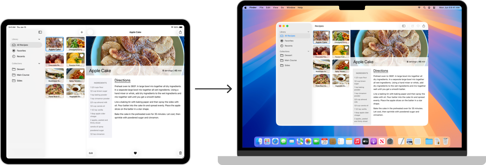

> 导航：[Technologies](../technologies.md) · [UIKit](../uikit.md)

# Mac Catalyst

API 集合

创建你的 iPad App 的一个版本，让用户可以在 Mac 设备上运行它。

## 概述

使用 Mac Catalyst，你可以制作 iPad App 的 Mac 版本。在 iPad App 的项目设置中勾选 Mac 复选框，即可把项目配置为同时构建 App 的 Mac 版本和 iPad 版本。这两个 App 共享同一个项目和源代码，因此可以轻松地在一处修改代码。

一张 iPad 和 Mac 笔记本电脑的照片，箭头从 iPad 指向 Mac。iPad 的屏幕显示一个示例食谱 App，笔记本电脑显示该示例 App 的 Mac 版本。

关于设计 iPad App 的 Mac 版本的信息，参见《人机界面指南》中的 [Mac Catalyst](https://developer.apple.com/design/human-interface-guidelines/ios/overview/mac-catalyst/)。

> [!important] 重要
> 使用 Mac Catalyst 构建的 Mac App 只能使用标记为在 Mac Catalyst 中可用的 [AppKit](../appkit.md) API，例如 [NSToolbar](../appkit/nstoolbar.md) 和 [NSTouchBar](../appkit/nstouchbar.md)。Mac Catalyst 不支持访问不可用的 AppKit API。

## 主题

### 基础

- [创建你的 iPad App 的 Mac 版本](creating-a-mac-version-of-your-ipad-app.md) — 通过 Mac Catalyst 把你的 iPad App 带到 macOS。

### App 支持

- [使用 Mac Catalyst 将 iPad App 带到 Mac](../tutorials/mac-catalyst.md) — 从与你的 iPad App 相同的代码库构建原生 Mac App。
- [为你的 Mac App 选择用户界面惯用法](choosing-a-user-interface-idiom-for-your-mac-app.md) — 在使用 Mac Catalyst 构建的 Mac App 中选择 iPad 或 Mac 用户界面惯用法。
- [为 Mac 优化你的 iPad App](optimizing-your-ipad-app-for-mac.md) — 利用 macOS 中的系统功能，让你的 iPad App 更像 Mac App。
- [LSMinimumSystemVersion](../bundleresources/information-property-list/lsminimumsystemversion.md) — App 在 macOS 中运行所需的操作系统最低版本。
- [UIApplicationSupportsTabbedSceneCollection](../bundleresources/information-property-list/uiapplicationscenemanifest/uiapplicationsupportstabbedscenecollection.md) — 一个布尔值，指示使用 Mac Catalyst 构建的 App 是否支持自动标签页模式。

### 用户界面

- [UIKit 目录：创建和自定视图与控制](uikit-catalog-creating-and-customizing-views-and-controls.md) — 使用视图和控制自定 App 的用户界面。
- [使用 Mac Catalyst 构建并改进你的 App](building-and-improving-your-app-with-mac-catalyst.md) — 通过支持原生控制、多个窗口、共享、打印、菜单和键盘快捷键，改进你的 iPadOS App。
- [在使用 Mac Catalyst 构建的 Mac App 中显示复选框](displaying-a-checkbox-in-your-mac-app-built-with-mac-catalyst.md) — 当你的 App 在 Mac 用户界面惯用法中运行时，将切换控制呈现为 Mac 风格的复选框。
- [移除使用 Mac Catalyst 构建的 Mac App 中的标题栏](removing-the-title-bar-in-your-mac-app-built-with-mac-catalyst.md) — 通过移除标题栏，显示填满窗口整个高度的内容。
- [工具栏](toolbar.md) — 在窗口标题栏下方、你自定义内容上方提供一处放置控制的空间。
- [Touch Bar](../appkit/touch-bar.md) — 在 Touch Bar 中显示交互式内容和控制。

### 用户交互

- [使用键盘导览 App 的用户界面](navigating-an-app-s-user-interface-using-a-keyboard.md) — 在 iPad App 和使用 Mac Catalyst 构建的 App 中，使用键盘和可获得焦点的 UI 元素在用户界面元素之间导览。
- [为菜单栏和用户界面添加菜单和快捷方式](adding-menus-and-shortcuts-to-the-menu-bar-and-user-interface.md) — 通过为使用 Mac Catalyst 构建的 Mac App 添加菜单和键盘快捷键，提供对有用操作的快速访问。
- [处理在物理键盘上进行的按键操作](handling-key-presses-made-on-a-physical-keyboard.md) — 检测某人在物理键盘上按下和释放按键的时刻。
- [UIHoverGestureRecognizer](uihovergesturerecognizer.md) — 一个连续手势识别器，用于解释指针在视图上的移动。

### 用户偏好设置

- [显示「设置」窗口](displaying-a-settings-window.md) — 在使用 Mac Catalyst 构建的 Mac App 中提供「设置」窗口，让用户可以管理在设置 bundle 中定义的 App 设置。
- [检测偏好设置窗口中的更改](detecting-changes-in-the-preferences-window.md) — 使用 Combine 在使用 Mac Catalyst 构建的 Mac App 中监听并响应用户的偏好设置更改。

### 工具提示

- [使用工具提示交互为视图和控制显示帮助标签](showing-help-tags-for-views-and-controls-using-tooltip-interactions.md) — 通过在某人将指针放到元素上时显示工具提示，解释界面元素的用途。
- [UIToolTipInteraction](uitooltipinteraction.md) — 一个交互对象，使得在指针悬停于视图或控制上时可以显示工具提示。
- [UIToolTipInteractionDelegate](uitooltipinteractiondelegate.md) — 一个为交互提供工具提示设置的接口。

## 另请参阅

### App 结构

- [App 与环境](app-and-environment.md) — 管理生命周期事件和 App 的 UI 场景，并获取有关特性（trait）以及 App 运行环境的信息。
- [文稿、数据和粘贴板](documents-data-and-pasteboard.md) — 组织 App 的数据，并在粘贴板上共享这些数据。
- [资源管理](resource-management.md) — 管理你用来实现 App 界面的图像、字符串、Storyboard 和 nib 文件。
- [App 扩展](app-extensions.md) — 把你的 App 的基本功能扩展到系统的其他部分。
- [进程间通信](interprocess-communication.md) — 向用户显示基于活动的服务。
