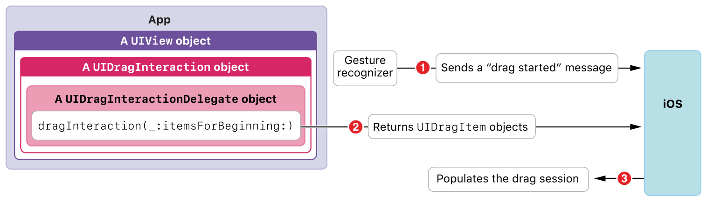

> 导航：[Technologies](../technologies.md) · [UIKit](../uikit.md) · [拖放](drag-and-drop.md)

# 使视图成为拖动源

<sub>文章</sub>

采用拖动交互 API 来提供可拖动的项目。

## 概述

通过为视图实现拖动交互委托（drag interaction delegate）（[UIDragInteractionDelegate](uidraginteractiondelegate.md)），你可以让该视图在 App 中充当拖动源。

> [!note] 注意
> [UITextView](uitextview.md)、[UITableView](uitableview.md) 和 [UICollectionView](uicollectionview.md) 类各自提供专门的创建拖动项目的支持。更多信息，参见这些类。

### 启用视图作为拖动源

[UIView](uiview.md) 的任何实例或子类都可以充当拖动源。你实现这一目标的初始步骤是：

1. 创建一个拖动交互（一个 [UIDragInteraction](uidraginteraction.md) 实例）。
2. 指定拖动交互的委托（一个符合 [UIDragInteractionDelegate](uidraginteractiondelegate.md) 协议的对象）。
3. 把该交互添加到视图的 [interactions](uiview/interactions.md) 属性。

以下是使用自定辅助方法实现此操作的方式，你通常会在视图控制器的 [- viewDidLoad](<uiviewcontroller/viewdidload().md>) 方法中调用它：

```swift
func customEnableDragging(on view: UIView, dragInteractionDelegate: UIDragInteractionDelegate) {
    let dragInteraction = UIDragInteraction(delegate: dragInteractionDelegate)
    view.addInteraction(dragInteraction)
}
```

### 创建拖动项目

拖动项目封装了源 App 对为一个模型对象提供多种数据表示的承诺。

要创建拖动项目，请在你的拖动交互委托中实现 [- dragInteraction:itemsForBeginningSession:](<uidraginteractiondelegate/draginteraction(__itemsforbeginning_).md>) 方法，以下是最简形式：

```swift
func dragInteraction(_ interaction: UIDragInteraction, itemsForBeginning session: UIDragSession) -> [UIDragItem] {
    // Cast to NSString is required for NSItemProviderWriting support.
    let stringItemProvider = NSItemProvider(object: "Hello World" as NSString)
    return [
        UIDragItem(itemProvider: stringItemProvider)
    ]
}
```

> [!note] 注意
> 上面的代码片段中，从 Swift 的 [String](../swift/string.md) 类型到 Foundation 的 [NSString](../foundation/nsstring.md) 类的转换是必需的，因为拖放的模型对象必须支持 [NSItemProviderWriting](../foundation/nsitemproviderwriting.md) 协议。

此实现使用 [init(object:)](<../foundation/nsitemprovider/init(object_).md>) 便捷初始化方法。当你实例化拖动项目时，传入以你的 App 的原生表示形式表示的对象，或者你支持的保真度最高的表示形式。通常，请确保项目提供器（item provider）的 [registeredTypeIdentifiers](../foundation/nsitemprovider/registeredtypeidentifiers.md) 数组中的第一个元素代表你的拖动交互委托能够交付的保真度最高的数据。

要向拖动项目添加更多数据表示（正如你在 App 中通常所做的那样），请按保真度从高到低的顺序添加它们。在添加表示时，你有以下选择：

- 在许多情况下，向拖动项目添加多种数据表示的最佳选择，是在你的模型类中采用 [NSItemProviderWriting](../foundation/nsitemproviderwriting.md) 协议。使用此协议，你可以把提供多种数据表示的代码放在模型类中。
- 你可以使用 [NSItemProvider](../foundation/nsitemprovider.md) 类的 [registerObject(_:visibility:)](<../foundation/nsitemprovider/registerobject(__visibility_).md>) 方法或相关方法，显式注册数据表示。

### 在上下文中理解拖动源

在 [- dragInteraction:itemsForBeginningSession:](<uidraginteractiondelegate/draginteraction(__itemsforbeginning_).md>) 协议方法中，你的源 App 响应系统的请求。该请求本身由用户在你的 App 界面中开始拖动项目触发。你的 App 与系统之间的对话按以下方式展开：



上图描绘了在上下文中构造拖动项目的步骤：

1. 用户通过对你的 App 中的视图进行长按，然后在仍接触屏幕的情况下移动手指，发起拖动活动。系统会实例化一个拖动会话（一个符合 [UIDragSession](uidragsession.md) 协议的对象，图中未显示）来管理该拖动活动。
2. 系统调用拖动交互委托的 [- dragInteraction:itemsForBeginningSession:](<uidraginteractiondelegate/draginteraction(__itemsforbeginning_).md>) 协议方法。你的委托返回一个或多个拖动项目。
3. 最后，系统用你的拖动项目填充拖动会话，准备让用户把拖动会话移动到目的地。

## 另请参阅

### 基础

- [将拖动项目理解为承诺](understanding-a-drag-item-as-a-promise.md) — 使用拖动项目在源 App 和目的地 App 之间传递数据表示承诺。
- [使视图成为放置目的地](making-a-view-into-a-drop-destination.md) — 采用放置交互 API，有选择地使用所拖内容。
- [在自定视图中采用拖放](adopting-drag-and-drop-in-a-custom-view.md) — 演示如何为 `UIImageView` 实例启用拖放。
- [在表格视图中采用拖放](adopting-drag-and-drop-in-a-table-view.md) — 演示如何为表格视图启用并实现拖放。
