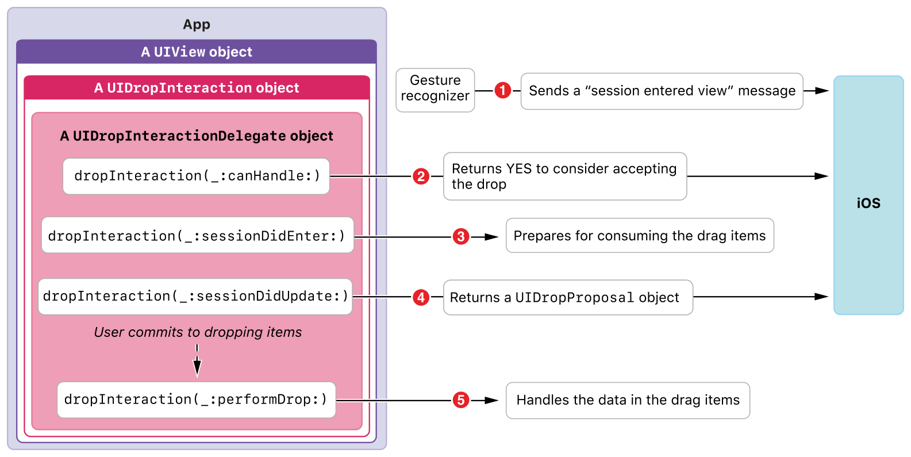

> 导航： [Technologies](../technologies.md) · [UIKit](../uikit.md) · [Drag and drop](drag-and-drop.md)

# 将视图变为放置目标

<sub>文章</sub>

采用放置交互 API 来选择性地消费拖拽内容。

## 概述

通过为视图实现放置交互 delegate（[UIDropInteractionDelegate](uidropinteractiondelegate.md)），你可以使该视图接受放置项。

> [!note] 注意
> [UITextView](uitextview.md)、[UITableView](uitableview.md) 和 [UICollectionView](uicollectionview.md) 类各自提供专门的支持来消费拖拽项。更多信息请参见这些类。

### 使视图成为放置目标

[UIView](uiview.md) 的任何实例或子类都可以充当放置目标。你要做的第一步是：

1. 创建一个放置交互（[UIDropInteraction](uidropinteraction.md) 实例）。
2. 指定放置交互的 delegate（符合 [UIDropInteractionDelegate](uidropinteractiondelegate.md) 协议的对象）。
3. 将该交互添加到视图的 [interactions](uiview/interactions.md) 属性。

做法如下：

```swift
func customEnableDropping(on view: UIView, dropInteractionDelegate: UIDropInteractionDelegate) {
    let dropInteraction = UIDropInteraction(delegate: dropInteractionDelegate)
    view.addInteraction(dropInteraction)
}
```

### 考虑接受拖拽项

当用户将拖拽会话的触摸点移动到放置目标上方时，你可以立即拒绝它，或者告诉系统继续与你的 delegate 对象进行对话。按如下方式提供你的响应：

```swift
func dropInteraction(_ interaction: UIDropInteraction, canHandle session: UIDropSession) -> Bool {
    // Ensure the drop session has an object of the appropriate type
    return session.canLoadObjects(ofClass: UIImage.self)
}
```

此示例假设你的放置目标只能消费 [UIImage](uiimage.md) 对象。方法实现会在 `return` 语句中测试此类型。你还可以使用此方法基于 App 的状态拒绝放置会话。_放置会话_ 是符合 [UIDropSession](uidropsession.md) 协议的系统管理对象。你可以访问放置会话以获取关于被放置项的信息。

[- dropInteraction:canHandleSession:](<uidropinteractiondelegate/dropinteraction(__canhandle_).md>) 方法是你的 App 唯一的机会来响应系统关于你的 App 是否会 _考虑_ 接受这些项的问题。例如，如果放置会话不包含你的 App 能消费的数据表示，或者考虑到你的 App 状态消费拖拽项不合适，你可能先发制人地拒绝放置会话。你的 App 最终接受或拒绝放置项的机会在你实现 [- dropInteraction:sessionDidUpdate:](<uidropinteractiondelegate/dropinteraction(__sessiondidupdate_).md>) 协议方法时。

### 提供必需的放置提议

要使视图有资格接受放置会话中的数据，你 _必须_ 实现 [- dropInteraction:sessionDidUpdate:](<uidropinteractiondelegate/dropinteraction(__sessiondidupdate_).md>) 协议方法。在你的实现中，返回一个放置提议——一个 [UIDropProposal](uidropproposal.md) 对象，指定放置操作类型，即 [UIDropOperation](uidropoperation.md) 枚举中的一个常量。

按如下方式提供放置提议：

```swift
func dropInteraction(_ interaction: UIDropInteraction, sessionDidUpdate session: UIDropSession) -> UIDropProposal {
        // Propose to the system to copy the item from the source app
        return UIDropProposal(operation: .copy)
}

```

如果你的 App 选择拒绝放置项，则返回 [UIDropOperationCancel](uidropoperation/cancel.md) 常量。

当用户将拖拽会话的触摸点移动到支持放置的视图上方时，系统会调用此协议方法——只要该视图没有在 [- dropInteraction:canHandleSession:](<uidropinteractiondelegate/dropinteraction(__canhandle_).md>) 方法中返回 `false` 而拒绝放置（参见 [Consider accepting the drag items](making-a-view-into-a-drop-destination.md#Consider-accepting-the-drag-items)）。

### 消费拖拽项中的数据

放置交互 delegate 与系统之间对话的最后一步，是你的 App 消费用户从源 App 拖拽的数据。在这里，你的放置交互 delegate 会请求放置会话加载其拖拽项：

```swift
func dropInteraction(_ interaction: UIDropInteraction, performDrop session: UIDropSession) {
    // Consume drag items (in this example, of type UIImage).
    session.loadObjects(ofClass: UIImage.self) { imageItems in
        let images = imageItems as! [UIImage]
        self.imageView.image = images.first
    }
    // Perform additional UI updates as needed.
}
```

[- dropInteraction:performDrop:](<uidropinteractiondelegate/dropinteraction(__performdrop_).md>) 方法是目标 App 请求拖拽项表示的唯一机会。接收项可能耗时并异步进行。_不要_ 在此方法中等待接收项；相反，快速从此方法返回。

> [!note] 注意
> 如果你像上面所示那样不使用 [- loadObjectsOfClass:completion:](<uidropsession/loadobjects(ofclass_completion_).md>) 便捷方法（它会自动使用主线程），请显式地将 UI 工作分派到主线程。例如，你可以使用 `DispatchQueue.main.async` 函数。

### 在上下文中理解放置目标

当放置会话的触摸点移动到你配置为放置目标的视图上方时，系统会与放置交互 delegate 开始对话。此对话为你的 App 提供了接受或拒绝放置、准备消费拖拽项、更新模型和 UI 的机会，如下所示：



上图描述了在上下文中消费拖拽项的步骤：

1. 用户在屏幕上移动手指，使拖拽会话的触摸点位于你 App 中已配置的视图内。系统实例化一个放置会话（符合 [UIDropSession](uidropsession.md) 协议的对象，图中未显示）来管理放置活动。
2. 系统调用放置交互 delegate 的 [- dropInteraction:canHandleSession:](<uidropinteractiondelegate/dropinteraction(__canhandle_).md>) 协议方法。检查你的 App 是否能并且选择消费拖拽项。
3. 系统调用 delegate 的 [- dropInteraction:sessionDidEnter:](<uidropinteractiondelegate/dropinteraction(__sessiondidenter_).md>) 协议方法。准备消费拖拽项。
4. 系统调用 delegate 的 [- dropInteraction:sessionDidUpdate:](<uidropinteractiondelegate/dropinteraction(__sessiondidupdate_).md>) 协议方法。你的实现 _必须_ 返回 [UIDropProposal](uidropproposal.md) 对象，否则系统会结束会话。
5. 如果用户确认他们完成放置的意图，系统会调用 delegate 的异步 [- dropInteraction:performDrop:](<uidropinteractiondelegate/dropinteraction(__performdrop_).md>) 协议方法。这是目标 App 请求拖拽项表示的唯一机会。

## 另请参阅

### 基础

- [Understanding a drag item as a promise](understanding-a-drag-item-as-a-promise.md) — 使用拖拽项在源 App 和目标 App 之间传递数据表示 promise。
- [Making a view into a drag source](making-a-view-into-a-drag-source.md) — 采用拖拽交互 API 来提供拖拽项。
- [Adopting drag and drop in a custom view](adopting-drag-and-drop-in-a-custom-view.md) — 演示如何为 `UIImageView` 实例启用拖放。
- [Adopting drag and drop in a table view](adopting-drag-and-drop-in-a-table-view.md) — 演示如何为表格视图启用并实现拖放。
