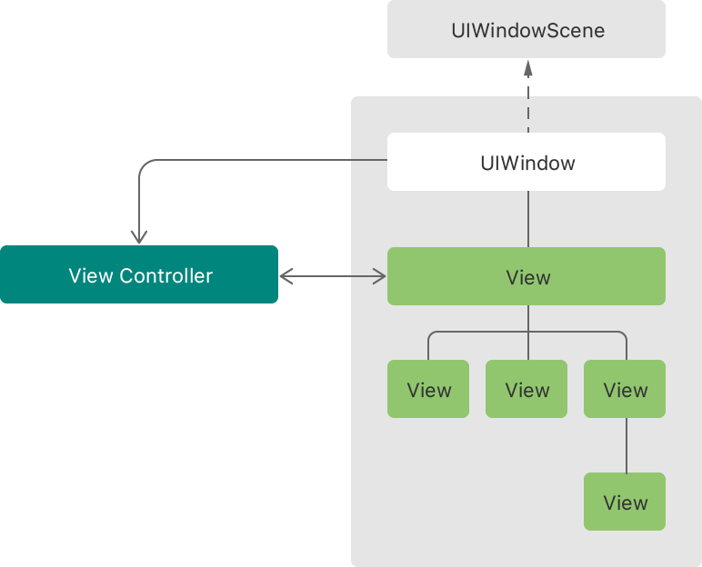
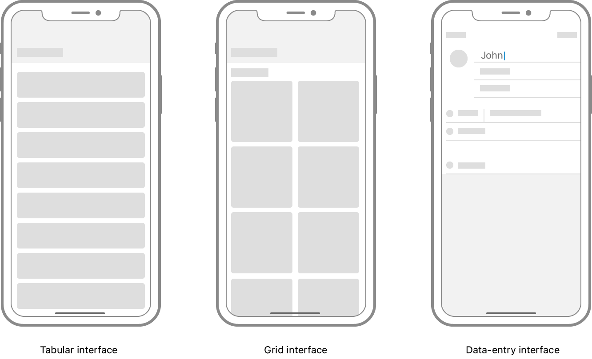
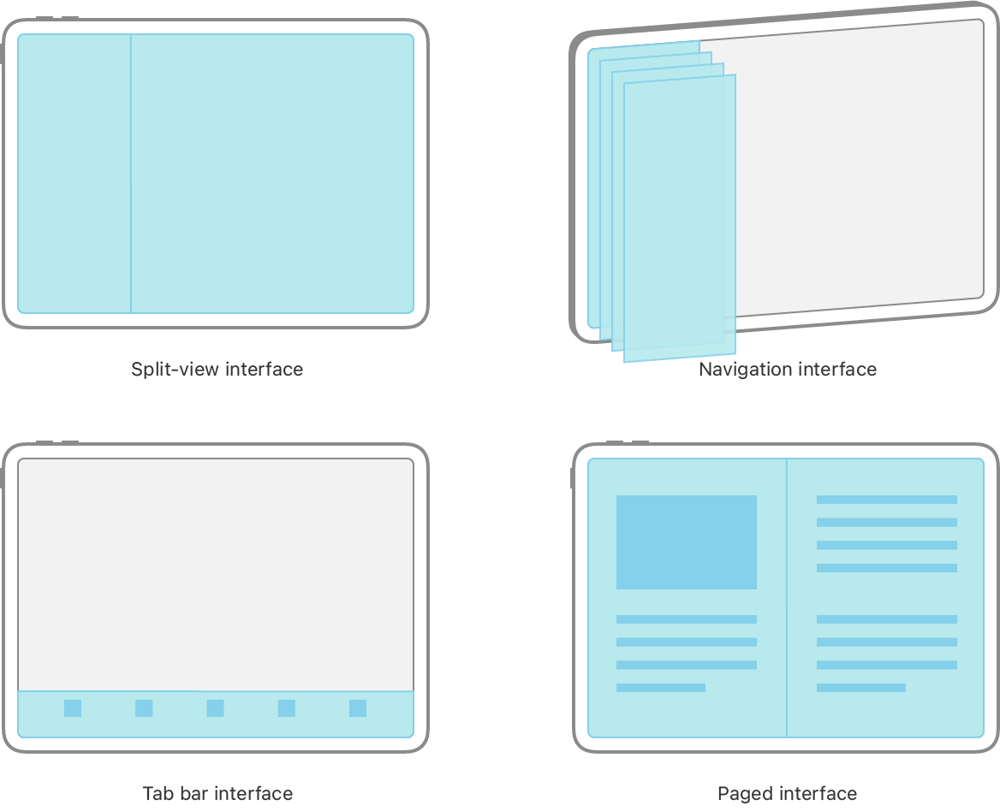
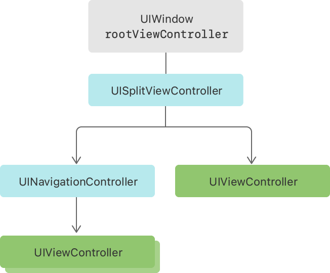

> 导航： [Technologies](../technologies.md) · [UIKit](../uikit.md) · [View controllers](view-controllers.md)

# 管理 App 窗口中的内容

文章

从视图控制器构建你的 App 用户界面，并在想要显示新内容时更改当前可见的视图控制器。

## 概述

你的 App UI 中的每个场景都包含一个窗口对象和一个或多个视图对象。窗口作为其余 UI 的不可见容器，作为视图的顶级容器，并将事件路由给它们。视图提供用户在屏幕上看到的实际内容，绘制文本、图像和其他类型的自定义内容。窗口是长期存在的对象，只有在拆除场景的整个 UI 时才会关闭它们。相比之下，你可能会频繁更改该窗口中的视图，尤其是当你想要显示新内容或信息时。

显示一个包含若干视图的窗口的架构图。视图控制器管理这些视图，窗口持有对视图控制器的引用。

为了有效管理你的视图，并使向窗口添加和移除它们变得容易，UIKit 提供了视图控制器。视图控制器管理 App 的一组视图，并使这些视图中的信息保持最新。每个窗口都有一个根视图控制器，你用它来指定窗口的初始视图集。当你想要更改该视图集时，你告诉 UIKit 呈现或关闭额外的视图控制器。UIKit 处理从一组视图到另一组视图的过渡，并通过你的视图控制器对象管理整个 App 界面。因此，视图控制器在实现 UI 中扮演重要角色。

### 为每个独特的页面内容定义视图控制器

在为新 App 设计 UI 时，首先将 UI 划分为不同的内容页面。每个页面代表显示 App 自定义信息的独特方式。例如，一个页面可能在表格中显示数据行，另一个可能在网格中显示图像，另一个可能显示用于捕获数据的一组文本栏。每个页面的结构和整体外观很重要；你从每个页面显示的具体数据并不重要。事实上，许多 App 在多个地方使用相同类型的页面，每个副本填充不同的数据集。

显示三种界面的插图。一种包含表格，第二种包含单元格网格，第三种包含数据录入界面。

对于每个独特的页面，定义一个视图控制器来表示该页面并管理其对应的视图。定义视图控制器总是涉及子类化并添加自定义行为。每个视图控制器都需要执行以下操作：

- 用数据填充其视图，并在数据更改时更新这些视图。
- 将数据更改报告回你的数据模型对象。
- 调整视图的大小、位置和可见性以匹配当前环境。
- 促进向其他内容页面的过渡。

更多信息，参见 [Displaying and managing views with a view controller](displaying-and-managing-views-with-a-view-controller.md)。

### 为你的内容选择导航模型

简单 App 可能只显示一个屏幕的内容，但大多数 App 有多个要显示的内容屏幕。为了使在这些视图控制器之间导航变得容易，UIKit 提供了实现常见导航模型的容器视图控制器。

容器视图控制器是一种特殊类型的视图控制器，它管理其他视图控制器，这些被称为其子视图控制器。容器的工作是将其每个子视图控制器的根视图定位在其自身视图的边界内。容器可能一次只呈现一个子视图，或同时呈现多个子视图。容器还可以对其子视图进行动画，使其在屏幕上或离开屏幕，以提供关于当前生效的导航类型的视觉反馈。

始终使用 UIKit 容器视图控制器来实现常见导航模型：

- [UINavigationController](uinavigationcontroller.md) 在 _导航界面_ 中管理子视图控制器的栈。将新的视图控制器压入栈会替换之前的视图控制器。弹出视图控制器会揭示下面的视图控制器。
- [UISplitViewController](uisplitviewcontroller.md) 在 _拆分视图界面_ 中并排管理两个子视图控制器（当空间可用时）。（当空间受限时，系统会在导航界面中显示这些视图控制器。）这种界面也称为 primary-detail 界面。
- [UITabBarController](uitabbarcontroller.md) 在 _标签页栏界面_ 的底部显示一行按钮。选择一个按钮会显示与该按钮关联的子视图控制器。
- [UIPageViewController](uipageviewcontroller.md) 在 _分页界面_ 中管理有序的子视图控制器序列，一次只呈现一个或两个。用户通过滑动或轻点在这些视图控制器之间导航。

标准 UIKit 容器界面类型的插图，包括拆分视图控制器、导航控制器、标签页栏控制器和页面视图控制器。

你可以组合多个 UIKit 容器视图控制器来创建新的导航模型。例如，将 [UINavigationController](uinavigationcontroller.md) 放置在拆分视图界面的左窗格（或主窗格）中很常见。你也可以创建自己的新容器视图控制器，从而创建 App 独有的全新导航模型。

除了容器视图控制器，你可以随时用新的视图控制器替换当前视图控制器的内容。呈现新的视图控制器会完全或部分覆盖之前的视图控制器。通常，你只在临时中断当前流程时，或当 App 的 UI 非常简单时，才呈现新的视图控制器。不要将它们用于更复杂的导航方案。

有关如何创建自己的容器视图控制器的信息，参见 [Creating a custom container view controller](creating-a-custom-container-view-controller.md)。

### 为每个窗口分配根视图控制器

根视图控制器定义窗口的初始导航模型。如果你使用 storyboard，根视图控制器是场景 storyboard 文件的初始视图控制器。如果你以编程方式创建窗口，请在显示窗口之前为窗口的 [rootViewController](uiwindow/rootviewcontroller.md) 属性赋值。

当根视图控制器是容器时，你还必须配置该容器显示的任何子视图控制器。大多数容器视图控制器只提供最少的 UI；其余内容由子视图控制器提供。例如，[UISplitViewController](uisplitviewcontroller.md) 提供的唯一可见内容是其左、右子视图控制器之间的分隔线。

## 另请参阅

### 基础

- [UIKit Catalog: Creating and customizing views and controls](uikit-catalog-creating-and-customizing-views-and-controls.md) — 使用视图与控件自定义你的 App 用户界面。
