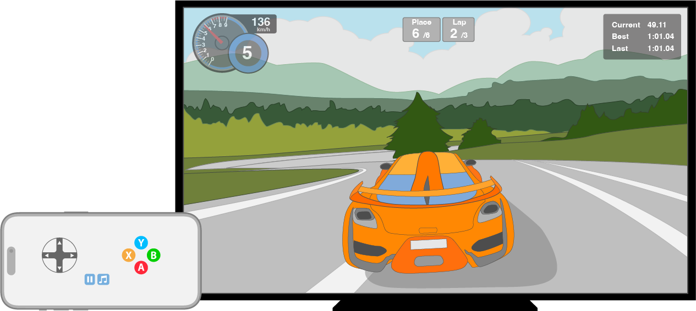

> 导航： [Technologies](../technologies.md) · [UIKit](../uikit.md) · [Windows and screens](windows-and-screens.md)

# 在已连接的显示器上呈现内容

<sub>文章</sub>

在已连接的显示器上填充来自你的 App 的附加内容。

## 概述

用户可以随时通过 AirPlay 或物理线缆将额外的显示器连接到 iOS 设备。当外部显示器连接时，系统会镜像你的 App 的主显示器；或者，在支持扩展显示器的兼容 iPad 机型上，在外部显示器上呈现你的 App 的交互式窗口。

每个额外的显示器都代表了可以呈现 App 内容的新空间。要在一个已连接的显示器上呈现内容，你需要将窗口附加到系统提供的 [UIWindowScene](uiwindowscene.md) 对象上，并使用场景 delegate 响应生命周期事件。

UIKit 定义了不同的 [Role](uiscenesession/role-swift.struct.md) 类型，用于指示用户如何与场景的内容进行交互。以下类型与显示在已连接屏幕上的内容有关：

- 具有 [UIWindowSceneSessionRoleApplication](uiscenesession/role-swift.struct/windowapplication.md) 角色的场景呈现交互式窗口。这些窗口在内置显示器或某些 iPad 机型的已连接显示器上渲染。多个场景的窗口可以同时呈现，且可能不占满整个屏幕。
- 具有 [UIWindowSceneSessionRoleExternalDisplayNonInteractive](uiscenesession/role-swift.struct/windowexternaldisplaynoninteractive.md) 角色的场景在已连接的显示器上呈现非交互式窗口。当 App 为该场景呈现内容时，内容会占满整个屏幕。

### 为场景配置你的项目

你需要向系统提供场景配置，以指定它创建 App 场景时所使用的信​​息，并指示你的 App 支持的场景类型。

默认情况下，Xcode 会预先配置新项目以使用具有 [UIWindowSceneSessionRoleApplication](uiscenesession/role-swift.struct/windowapplication.md) 角色的场景。搭载 M1 芯片的 iPad 机型可以在使用 Stage Manager、外部键盘和指点设备时，通过这种类型的场景在已连接的屏幕上呈现交互式内容。

注册一个场景 accessory，以便在已连接的显示器上呈现非交互式内容，以补充你的 App 在内置屏幕上呈现的交互式内容。例如，游戏可以在已连接的显示器上显示其内容，同时在内置屏幕上显示游戏控制。



更多信息，参见 [Specifying the scenes your app supports](specifying-the-scenes-your-app-supports.md)。

### 为非交互式内容注册场景 accessory

_场景 accessory_ 声明了系统代表你的 App 呈现的补充内容，当相关功能可用时（例如通过线缆或 AirPlay 连接的外部显示器）。你的 App 声明要提供什么内容，系统决定何时以及在哪里呈现它。由于内容仅在显示器可用时才会出现，因此请将你的 App 设计成在没有外部显示器时也能完全正常运行。

从 iOS 27 开始，你的 App 只有在注册了场景 accessory 后才会收到具有 [UIWindowSceneSessionRoleExternalDisplayNonInteractive](uiscenesession/role-swift.struct/windowexternaldisplaynoninteractive.md) 角色的场景。在更早的版本中，系统会自动连接该场景，而 App 通过拒绝为它提供内容来选择退出。如果你的 App 之前通过检查 [- application:configurationForConnectingSceneSession:options:](<uiapplicationdelegate/application(__configurationforconnecting_options_).md>) 或场景 delegate 中连接场景的角色来提供内容，请移除该与角色相关的逻辑，并改为注册一个场景 accessory。你可以复用现有的场景 delegate 作为 accessory 的 delegate 类，或创建一个专门用于外部显示器场景的新 delegate。

要注册场景 accessory，请为非交互式外部显示器内容创建一个 [UISceneAccessory](uisceneaccessory.md)，并将其注册到你的 App 主界面中的一个视图控制器上。选择其内容由外部显示器补充的视图控制器，然后传递一个 [UISceneConfiguration](uisceneconfiguration.md)，用于标识要使用的场景 delegate，可以通过直接设置其 [delegateClass](uisceneconfiguration/delegateclass.md)，或提供与你的信息属性列表场景清单中的配置相匹配的名称来完成。注册会返回一个 [UISceneAccessoryRegistration](uisceneaccessoryregistration.md)，你需要保留它以观察和控制该 accessory：

```swift
class PlayerViewController: UIViewController {
    var displayRegistration: UISceneAccessoryRegistration?

    override func viewDidLoad() {
        super.viewDidLoad()

        // 描述要呈现的场景，包括附加其窗口的 delegate。
        let configuration = UISceneConfiguration()
        configuration.delegateClass = ExternalDisplaySceneDelegate.self

        // 注册 accessory，以便系统可以在外部显示器上呈现此内容。
        let accessory = UISceneAccessory.externalNonInteractive(sceneConfiguration: configuration)
        displayRegistration = registerSceneAccessory(accessory)
    }
}
```

只要你的 App 呈现该视图控制器、注册处于启用状态且外部显示器可用，系统就会连接非交互式外部显示器场景。然后，系统会在你指定的场景 delegate 上调用 [- scene:willConnectToSession:options:](<uiscenedelegate/scene(__willconnectto_options_).md>)，你在其中附加一个 [UIWindow](uiwindow.md) 来呈现内容。该场景的内容会占满整个屏幕。当 App 关闭该视图控制器或显示器断开连接时，系统会断开该场景并调用 [- sceneDidDisconnect:](<uiscenedelegate/scenediddisconnect(__).md>)。

如果你的 App 中有多个视图控制器注册了外部显示器 accessory，系统会呈现属于最顶层、最近呈现的视图控制器的那个注册。

使用 [UISceneAccessoryRegistration](uisceneaccessoryregistration.md) 来控制和观察该 accessory：

- 将 [enabled](uisceneaccessoryregistration/isenabled.md) 设为 `false` 可以在不放弃注册的情况下停止呈现你的内容，再将其设回 `true` 即可恢复。
- 读取 [available](uisceneaccessoryregistration/isavailable.md) 以了解系统当前是否可以呈现该 accessory。该属性支持在 [- updateProperties](<uiviewcontroller/updateproperties().md>) 和 [- layoutSubviews](<uiview/layoutsubviews().md>) 中进行观察追踪。

要完全停止提供该内容，请使用 [- unregisterSceneAccessory:](<uiviewcontroller/unregistersceneaccessory(__).md>) 取消注册该 accessory。如果系统正在呈现该 accessory，它会关闭该场景：

```swift
if let displayRegistration {
    unregisterSceneAccessory(displayRegistration)
    self.displayRegistration = nil
}
```

要在场景连接时向场景 delegate 传递额外的上下文，请使用 [+ externalNonInteractiveSceneAccessoryWithConfiguration:userInfo:](<uisceneaccessory/externalnoninteractive(sceneconfiguration_userinfo_).md>) 创建 accessory，并在 [- scene:willConnectToSession:options:](<uiscenedelegate/scene(__willconnectto_options_).md>) 中从 [sceneAccessoryUserInfo](uiscene/connectionoptions/sceneaccessoryuserinfo.md) 读取该值。

### 将窗口附加到场景

你的场景 delegate 通过其 [- scene:willConnectToSession:options:](<uiscenedelegate/scene(__willconnectto_options_).md>) 方法接收连接的场景。使用该方法及其提供的会话对象来配置并将窗口附加到场景。系统会将你提供的窗口显示在窗口场景的当前屏幕上。

此示例配置一个窗口，使其在场景的显示器上渲染。

```swift
func scene(_ scene: UIScene, willConnectTo session: UISceneSession, options connectionOptions: UIScene.ConnectionOptions) {
    guard let windowScene = (scene as? UIWindowScene) else { return }

    let window = UIWindow(windowScene: windowScene)
    window.rootViewController = ViewController()
    self.window = window
    window.makeKeyAndVisible()
}
```

使用 storyboard 时，系统会为你初始化并将窗口附加到场景。

除了调用此方法外，UIKit 还会发布 [UISceneWillConnectNotification](uiscene/willconnectnotification.md) 通知。

### 处理断开连接

当系统断开你的 App 与某个场景的连接时（可能发生在用户断开显示器时），你的 App 会通过该场景 delegate 上的 [- sceneDidDisconnect:](<uiscenedelegate/scenediddisconnect(__).md>) 方法收到调用。使用此方法执行任何最终清理，并在必要时更新其他场景呈现的内容。

除了调用此方法外，UIKit 还会发布 [UISceneDidDisconnectNotification](uiscene/diddisconnectnotification.md) 通知。

### 处理与已连接显示器之间的过渡

场景在其生命周期内可能会出现在不同的显示器上。如果你使用 [UIScreen](uiscreen.md) 对象的信息，请使用窗口场景的 [screen](uiwindowscene/screen.md) 属性以上下文方式获取它。

如果你的 App 需要知道场景何时更改屏幕，请使用场景 delegate 的 [- windowScene:didUpdateCoordinateSpace:interfaceOrientation:traitCollection:](<uiwindowscenedelegate/windowscene(__didupdate_interfaceorientation_traitcollection_).md>) 方法。

此示例使用显示链接，并在场景更改屏幕时更新该链接。

```swift
class ExternalDisplaySceneDelegate: UIResponder, UIWindowSceneDelegate {
    var window: UIWindow?
    var screen: UIScreen?

    func scene(_ scene: UIScene, willConnectTo session: UISceneSession, options connectionOptions: UIScene.ConnectionOptions) {
        guard let windowScene = (scene as? UIWindowScene) else { return }

        if session.role == .windowExternalDisplayNonInteractive {
            let window = UIWindow(windowScene: windowScene)
            window.rootViewController = ExternalDisplayViewController()
            self.window = window
            window.makeKeyAndVisible()
            ...
            setupDisplayLinkIfNecessary()
        }
    }

    func windowScene(_ windowScene: UIWindowScene, didUpdate previousCoordinateSpace: UICoordinateSpace, interfaceOrientation previousInterfaceOrientation: UIInterfaceOrientation, traitCollection previousTraitCollection: UITraitCollection) {
        setupDisplayLinkIfNecessary()
    }

    weak var linkedScreen: UIScreen?

    func setupDisplayLinkIfNecessary() {
        let currentScreen = self.screen
        if currentScreen != linkedScreen {
            // Set up display link
            ...
            self.linkedScreen = currentScreen
        }
    }

    ...
}
```

### 更改外部显示器的屏幕模式

许多显示器支持多种分辨率，其中一些使用不同的像素纵横比。默认情况下，屏幕对象使用最常见的屏幕模式，但当它们为具有 [UIWindowSceneSessionRoleExternalDisplayNonInteractive](uiscenesession/role-swift.struct/windowexternaldisplaynoninteractive.md) 角色的场景的内容显示时，支持更改该模式。例如，如果你正在使用 640 x 480 像素屏幕的纹理实现游戏，你可能会更改具有更高默认分辨率的屏幕的屏幕模式。不要尝试更改具有 [UIWindowSceneSessionRoleApplication](uiscenesession/role-swift.struct/windowapplication.md) 角色的场景屏幕的模式。

如果你打算使用默认模式以外的屏幕模式，请在将屏幕与窗口关联之前，将该模式应用到 [UIScreen](uiscreen.md) 对象。[UIScreenMode](uiscreenmode.md) 类定义了单个屏幕模式的属性。你可以从屏幕的 [availableModes](uiscreen/availablemodes.md) 属性获取它支持的模式列表，然后遍历该列表以找到符合你需求的模式。

有关屏幕模式的更多信息，参见 [UIScreenMode](uiscreenmode.md)。

## 另请参阅

### 相关文档

- [Multitasking on iPad, Mac, and Apple Vision Pro](multitasking-on-ipad-mac-and-apple-vision-pro.md) — 实现多任务 API，以便将你的 App 与 iPadOS、macOS 和 visionOS 无缝集成。
- [Managing your app’s life cycle](managing-your-app-s-life-cycle.md) — 当你的 App 位于前台或后台时，响应系统通知，并处理其他重要的与系统相关的事件。
- [Building a desktop-class iPad app](building-a-desktop-class-ipad-app.md) — 通过采用多任务处理、文档交互、文本编辑、搜索等的桌面级增强功能，优化你的 iPad App 的用户体验。

### Screens

- [UIScreen](uiscreen.md) — 定义与基于硬件的显示器相关的属性的对象。
- [UIScreenMode](uiscreenmode.md) — 可以应用到屏幕对象的一组可能属性。
