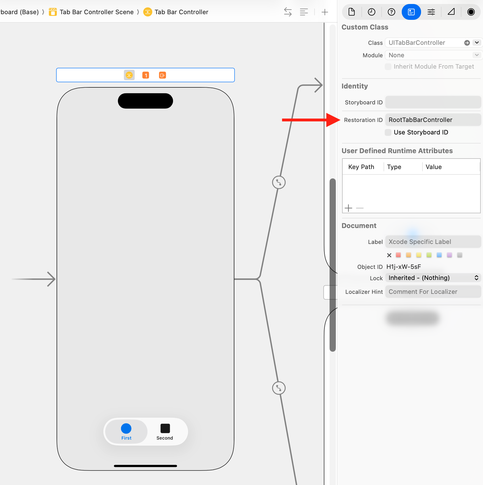

> 导航：[技术](../technologies.md) · [UIKit](../uikit.md) · [视图控制器](view-controllers.md)

# 在多次启动之间保留 App 的界面

在系统终止你的 App 后，让它返回到之前的状态。

## 概述

保留 App 的用户界面有助于维持 App 始终在运行的错觉。iOS 设备上的中断可能频繁发生，长时间的中断可能导致系统终止你的 App 以释放资源。然而，用户并不知道你的 App 已被终止，也不会期望 App 的状态发生变化。他们期望的是你的 App 保持在他们离开时的状态。状态保留与恢复确保你的 App 再次启动时返回到之前的状态。

UIKit 会在适当的时机把 App 的视图和视图控制器的状态保留到磁盘上的一个加密文件中。当你的 App 被终止并稍后重新启动时，UIKit 会根据保留的数据重建你的视图和视图控制器。保留和恢复过程会自动启动，但你也必须做一些具体工作来支持这些过程：

- 启用对状态保留与恢复的支持。
- 为你想保留的视图控制器指定恢复标识符。
- 在恢复时按需重建视图控制器。
- 对把视图控制器恢复到之前状态所需的自定数据进行编码和解码。

如果你完全在 storyboard 中定义界面，UIKit 知道如何重建你的视图控制器，并会自动完成。如果你不使用 storyboard，或者想对视图控制器的创建和初始化有更多控制，你可以自己创建它们。

要查看状态保留与恢复的示例，请参阅[恢复你的 App 的状态](restoring-your-app-s-state.md)。

### 为你的 App 启用状态保留与恢复

你通过实现 App 委托的 [- application:shouldSaveSecureApplicationState:](<uiapplicationdelegate/application(__shouldsavesecureapplicationstate_).md>) 和 [- application:shouldRestoreSecureApplicationState:](<uiapplicationdelegate/application(__shouldrestoresecureapplicationstate_).md>) 方法来选择加入状态保留与恢复。这两个方法都返回一个布尔值，指示是否应进行相应的过程；在大多数情况下，你只需返回 [true](../swift/true.md)。不过，在恢复 App 界面可能不合适的时候，你也可以返回 [false](../swift/false.md)。

当 UIKit 调用你的 [- application:shouldSaveSecureApplicationState:](<uiapplicationdelegate/application(__shouldsavesecureapplicationstate_).md>) 方法时，除了返回 [true](../swift/true.md)，你还可以保存数据。你可以保存打算在恢复过程中使用的数据。例如，下面的代码展示了一个保存 App 当前版本号的示例。在恢复时，[- application:shouldRestoreSecureApplicationState:](<uiapplicationdelegate/application(__shouldrestoresecureapplicationstate_).md>) 方法会检查归档中的版本号，如果与预期版本不符，则阻止恢复发生。

```swift
func application(_ application: UIApplication, 
            shouldSaveSecureApplicationState coder: NSCoder) -> Bool {
   // 将当前 App 版本保存到归档。
   coder.encode(11.0, forKey: "MyAppVersion")
        
   // 始终保存状态信息。
   return true
}
    
func application(_ application: UIApplication, 
            shouldRestoreSecureApplicationState coder: NSCoder) -> Bool {
   // 仅在 App 版本匹配时恢复状态。
   let version = coder.decodeFloat(forKey: "MyAppVersion")
   if version == 11.0 {
      return true
   }
    
   // 不要从旧数据恢复。    
   return false
}
```

如果你阻止了恢复的发生，你仍然可以在 App 委托的 [- application:didFinishLaunchingWithOptions:](<uiapplicationdelegate/application(__didfinishlaunchingwithoptions_).md>) 方法中手动配置 App 的界面。

### 为你的视图控制器指定恢复标识符

你通过为视图控制器指定恢复标识符，来显式告诉 UIKit 要保留哪些视图控制器。恢复标识符是你以编程方式或在 Interface Builder 中指定给视图控制器的一个唯一字符串。视图控制器类的名称通常是一个合适的恢复标识符，但你可以使用任何字符串。将该字符串添加到 storyboard 文件中的视图控制器，或在运行时把它指定给视图控制器的 [restorationIdentifier](uiviewcontroller/restorationidentifier.md) 属性。



在保留时，UIKit 会尝试保留 App 各窗口的根视图控制器。对于每个带有恢复标识符的根视图控制器，UIKit 会要求该视图控制器把它的自定数据编码到归档中。容器视图控制器可以将其子视图控制器的引用编码为其自定数据的一部分。如果这样做，且这些视图控制器也有恢复标识符，UIKit 会尝试保留这些子视图控制器及其内容。此过程递归地进行，沿着从一个视图控制器到下一个视图控制器的连接，直到所有视图控制器都被保存或忽略。

你不必须为每个视图控制器都指定恢复标识符。事实上，有时你可能并不想保留所有视图控制器。例如，如果你的 App 显示一个临时的登录屏幕，你可能不希望保留该屏幕；而是希望在恢复时再决定是否显示它。在这种情况下，就不要为登录屏幕的视图控制器指定恢复标识符。

有关哪些内容会被保留的详细信息，请参阅[关于 UI 保留过程](about-the-ui-preservation-process.md)。

### 为你的 App 编码和解码自定信息

在保留过程中，UIKit 会调用每个被保留的视图和视图控制器的 [- encodeRestorableStateWithCoder:](<uistaterestoring/encoderestorablestate(with_).md>) 方法。使用此方法来保留把视图或视图控制器恢复到当前状态所需的信息。

- **应该**保存视图和控制的视觉状态细节。
- **应该**保存你同样想保留的子视图控制器的引用。
- **应该**保存那些即使丢弃也不会影响用户数据的信息。
- **不应该**包含已经存在于 App 持久化存储中的数据。相反，应包含一个标识符，供你稍后用来定位那些数据。

状态保留并不是把 App 数据保存到磁盘的替代品。UIKit 可以自行决定丢弃状态保留数据，让 App 回到其默认状态。请使用保留过程来存储关于 App 用户界面状态的信息，例如表格中当前选中的行。不要用它来存储该表格中包含的数据。

下面的代码展示了一个带有用于收集名字和姓氏的文本栏的视图控制器示例。如果某个文本栏中包含未保存的值，该方法会保存这个未保存的值以及标识哪个文本栏包含该值的标识符。在这里，未保存的值不属于 App 的持久化数据；它是一个临时值，必要时可以丢弃。

```swift
override func encodeRestorableState(with coder: NSCoder) {
   super.encodeRestorableState(with: coder)
        
   // 保存用户 ID，以便稍后加载该用户。
   coder.encode(userID, forKey: "UserID")

   // 如果正在编辑，写出任何临时数据。
   if firstNameField!.isFirstResponder {
      coder.encode(firstNameField?.text, forKey: "EditedText")
      coder.encode(Int32(1), forKey: "EditField")
   }
   else if lastNameField!.isFirstResponder {
      coder.encode(lastNameField?.text, forKey: "EditedText")
      coder.encode(Int32(2), forKey: "EditField")
   }
   else {
      // 没有正在进行的编辑。
      coder.encode(Int32(0), forKey: "EditField")
   }
}
```

有关 UIKit 如何保留你的 App 的视图、视图控制器和状态信息的更多信息，请参阅[关于 UI 保留过程](about-the-ui-preservation-process.md)。

### 在被要求时创建视图控制器

如果在你的 App 启动时有可用的保留状态信息，系统会尝试使用保留的数据恢复你的 App 界面。

1. UIKit 调用你的 App 委托的 [- application:shouldRestoreSecureApplicationState:](<uiapplicationdelegate/application(__shouldrestoresecureapplicationstate_).md>) 方法来确定是否应继续恢复。
2. UIKit 使用你的 App 的 storyboard 来重建你的视图控制器。
3. UIKit 调用每个视图控制器的 [- decodeRestorableStateWithCoder:](<uistaterestoring/decoderestorablestate(with_).md>) 方法来恢复其状态信息。

UIKit 最初会从你的 storyboard 加载视图控制器及其视图。在这些对象被加载并初始化之后，UIKit 开始恢复它们的状态信息。使用你的 [- decodeRestorableStateWithCoder:](<uistaterestoring/decoderestorablestate(with_).md>) 方法把视图控制器返回到之前的状态。

下面的代码展示了用于解码上一个示例所编码状态的方法。此方法从保留的用户 ID 恢复视图控制器的数据。如果有文本栏正在被编辑，此方法还会恢复进行中的值，并让相应的文本栏成为第一响应者，这会显示该文本栏的键盘。

```swift
override func decodeRestorableState(with coder: NSCoder) {
   super.decodeRestorableState(with: coder)
   
   // 从用户 ID 恢复名字和姓氏。
   let identifier = coder.decodeObject(forKey: "UserID") as! String
   setUserID(identifier: identifier)

   // 恢复一个未保存的进行中的值。
   let activeField = coder.decodeInteger(forKey: "EditField")
   let editedText = coder.decodeObject(forKey: "EditedText") as! 
                         String?

   switch activeField {
      case 1:
         firstNameField?.text = editedText
         firstNameField?.becomeFirstResponder()
         break
            
      case 2:
         lastNameField?.text = editedText
         lastNameField?.becomeFirstResponder()
         break
            
     default:
         break  // 不执行任何操作。
  }
}
```

在 storyboard 中定义视图控制器是管理状态恢复的最简单方式，但并非唯一方式。有关重建视图控制器的其他方式的更多信息，请参阅[关于 UI 恢复过程](about-the-ui-restoration-process.md)。

## 主题

### 过程细节

- [关于 UI 保留过程](about-the-ui-preservation-process.md) — 了解如何自定 UIKit 的状态保留过程。
- [关于 UI 恢复过程](about-the-ui-restoration-process.md) — 了解如何自定 UIKit 的状态恢复过程。

## 另请参阅

### 界面恢复

- [恢复你的 App 的状态](restoring-your-app-s-state.md) — 通过保留当前活动来为用户提供连续性。
- [使用 SwiftUI 恢复你的 App 的状态](../swiftui/restoring-your-app-s-state-with-swiftui.md) — 通过保留用户的当前活动为用户提供 App 连续性。
- [UIViewControllerRestoration](uiviewcontrollerrestoration.md) — 对象采用这些方法后，即可在状态恢复期间充当视图控制器的恢复类。
- [UIObjectRestoration](uiobjectrestoration.md) — 恢复类用来还原已保留对象的接口。
- [UIStateRestoring](uistaterestoring.md) — 用于将对象添加到状态恢复归档的方法。
