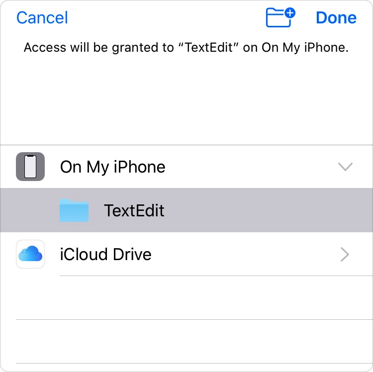

> 导航： [Technologies](../technologies.md) · [UIKit](../uikit.md) · [View controllers](view-controllers.md)

# 提供对目录的访问

<sub>文章</sub>

使用文稿选择器访问 App 容器外部的目录内容。

## 概述

在 iOS 12 及更早版本中，用户可以打开并交互 App 容器外部的文件。[UIDocumentBrowserViewController](uidocumentbrowserviewcontroller.md) 和 [UIDocumentPickerViewController](uidocumentpickerviewcontroller.md) 提供对系统本地文件提供商、iCloud 或使用 File Provider 扩展的第三方服务中的文件的访问。用户可以一次选择多个文件——但他们需要逐个选择每个文件。

在 iOS 13 中，用户可以使用 [UIDocumentPickerViewController](uidocumentpickerviewcontroller.md) 从任何可用的文件提供商中选择一个目录。文稿选择器会返回一个 _安全作用域 URL_，允许你的 App 访问其容器外部的内容。在这种情况下，该 URL 允许你的 App 递归访问该目录及其所有内容，包括访问你将来添加到该目录中的任何新项。你的 App 甚至可以为此 URL 保存一个书签，以便下次启动时访问该目录。

### 提示用户选择目录

要提示用户选择目录，请创建一个文稿选择器，并将要打开的内容类型设置为 [folder](../uniformtypeidentifiers/uttype-swift.struct/folder.md) 类型。然后设置文稿选择器的 delegate 并呈现它。

```swift
// Create a document picker for directories.
let documentPicker =
    UIDocumentPickerViewController(forOpeningContentTypes: [.folder])
documentPicker.delegate = self

// Set the initial directory.
documentPicker.directoryURL = startingDirectory

// Present the document picker.
present(documentPicker, animated: true, completion: nil)
```

一旦你调用 [- presentViewController:animated:completion:](<uiviewcontroller/present(__animated_completion_).md>) 方法，系统就会向用户显示文稿选择器。如果你指定了 [directoryURL](uidocumentpickerviewcontroller/directoryurl.md) 属性，文稿选择器会从所选目录开始。否则，它会从用户最近选择的目录开始。



用户轻点 Done 后，系统会调用你的 delegate 的 [- documentPicker:didPickDocumentsAtURLs:](<uidocumentpickerdelegate/documentpicker(__didpickdocumentsat_).md>) 方法，传入一个包含用户所选目录的安全作用域 URL 数组。使用安全作用域 URL 来枚举目录及其任何子目录的内容，或添加、移除或修改任何文件。

如果用户轻点 Cancel，系统会改为调用 [- documentPickerWasCancelled:](<uidocumentpickerdelegate/documentpickerwascancelled(__).md>)。

> [!note] 注意
> [UIDocumentBrowserViewController](uidocumentbrowserviewcontroller.md) 不支持 [folder](../uniformtypeidentifiers/uttype-swift.struct/folder.md) 文稿类型。要提供对目录的访问，请改用 [UIDocumentPickerViewController](uidocumentpickerviewcontroller.md)。

### 访问目录的内容

当用户在文稿选择器中选择一个目录时，系统会授予你的 App 访问该目录及其所有内容的权限。文稿选择器会返回该目录的安全作用域 URL。当你使用其中一个 URL 来枚举目录内容时，生成的 URL 也是安全作用域的。你可以将安全作用域 URL 保存为书签，稍后将其解析回安全作用域 URL。

要访问安全作用域 URL 的内容，你必须执行以下操作：

1. 在访问 URL 之前，调用 [startAccessingSecurityScopedResource()](<../foundation/nsurl/startaccessingsecurityscopedresource().md>)。
2. 使用文件协调器对 URL 的内容执行读取或写入操作。
3. 访问 URL 后，调用 [stopAccessingSecurityScopedResource()](<../foundation/nsurl/stopaccessingsecurityscopedresource().md>)。

```swift
func documentPicker(_ controller:UIDocumentPickerViewController, didPickDocumentsAt urls: [URL]) {
    // Start accessing a security-scoped resource.
    guard let url = urls.first,
        url.startAccessingSecurityScopedResource() else {
        // Handle the failure here.
        return
    }

    // Make sure you release the security-scoped resource when you finish.
    defer { url.stopAccessingSecurityScopedResource() }

    // Use file coordination for reading and writing any of the URL’s content.
    var error: NSError? = nil
    NSFileCoordinator().coordinate(readingItemAt: url, error: &error) { (url) in
            
        let keys : [URLResourceKey] = [.nameKey, .isDirectoryKey]
            
        // Get an enumerator for the directory's content.
        guard let fileList =
            FileManager.default.enumerator(at: url, includingPropertiesForKeys: keys) else {
            Swift.debugPrint("*** Unable to access the contents of \(url.path) ***\n")
            return
        }
            
        for case let file as URL in fileList {
            // Start accessing the content's security-scoped URL.
            guard file.startAccessingSecurityScopedResource() else {
                // Handle the failure here.
                continue
            }

            // Do something with the file here.
            Swift.debugPrint("chosen file: \(file.lastPathComponent)")
                
            // Make sure you release the security-scoped resource when you finish.
            file.stopAccessingSecurityScopedResource()
        }
    }
}
```

### 将 URL 保存为书签

要在未来访问 URL，请使用其 [bookmarkData(options:includingResourceValuesForKeys:relativeTo:)](<../foundation/nsurl/bookmarkdata(options_includingresourcevaluesforkeys_relativeto_).md>) 方法将其保存为 [minimalBookmark](../foundation/nsurl/bookmarkcreationoptions/minimalbookmark.md)。

```swift
do {
    // Start accessing a security-scoped resource.
    guard url.startAccessingSecurityScopedResource() else {
        // Handle the failure here.
        return
    }
    
    // Make sure you release the security-scoped resource when you finish.
    defer { url.stopAccessingSecurityScopedResource() }
    
    let bookmarkData = try url.bookmarkData(options: .minimalBookmark, includingResourceValuesForKeys: nil, relativeTo: nil)
    
    try bookmarkData.write(to: getMyURLForBookmark())
}
catch let error {
    // Handle the error here.
}
```

然后你可以读取书签，并再次将其解析为安全作用域 URL。

```swift
do {
    let bookmarkData = try Data(contentsOf: getMyURLForBookmark())
    var isStale = false
    let url = try URL(resolvingBookmarkData: bookmarkData, bookmarkDataIsStale: &isStale)
    
    guard !isStale else {
        // Handle stale data here.
        return
    }
    
    // Use the URL here.
}
catch let error {
    // Handle the error here.
}
```

### 响应权限更改

用户始终完全控制可以访问目录的 App。在从文稿选择器选择目录后，你的 App 会出现在「设置」\>「隐私与安全性」\>「文件与文件夹」中。此页面列出所有有权访问共享目录的 App，用户可以随时撤销或恢复每个 App 的权限。

这意味着你的 App 必须准备好在访问目录内容时处理失败。调用 [startAccessingSecurityScopedResource()](<../foundation/url/startaccessingsecurityscopedresource().md>) 方法可能失败，任何读取或写入 URL 的尝试也可能失败。在保存和解析安全作用域 URL 的书签时尤其如此，因为使用保存的书签会大大增加用户可能更改 App 权限的时间窗口。

## 另请参阅

### Documents and directories

- [Customizing a document-based app’s launch experience](customizing-a-document-based-app-s-launch-experience.md) — 为你的 App 的文稿启动场景添加独特的元素。
- [Adding a document browser to your app](adding-a-document-browser-to-your-app.md) — 让人从你的 App 内访问其本地或远程文稿。
- [Building an app with a document browser](building-an-app-with-a-document-browser.md) — 通过向你的 App 添加文稿浏览器，提供对设备上和云端文件的访问。
- [Building a document browser app for custom file formats](building-a-document-browser-app-for-custom-file-formats.md) — 实现自定义文稿文件格式，以管理用户与不同云存储提供商上文件的交互。
- [UIDocumentViewController](uidocumentviewcontroller.md) — 管理并呈现存储在本地或云端的文稿的视图控制器。
- [UIDocumentBrowserViewController](uidocumentbrowserviewcontroller.md) — 用于浏览和对本地及云端存储的文稿执行操作的视图控制器。
- [UIDocumentPickerViewController](uidocumentpickerviewcontroller.md) — 提供对 App 沙盒外部文稿或目标的访问的视图控制器。
- [UIDocumentInteractionController](uidocumentinteractioncontroller.md) — 预览、打开或打印 App 无法直接处理的文件格式的文件的视图控制器。
