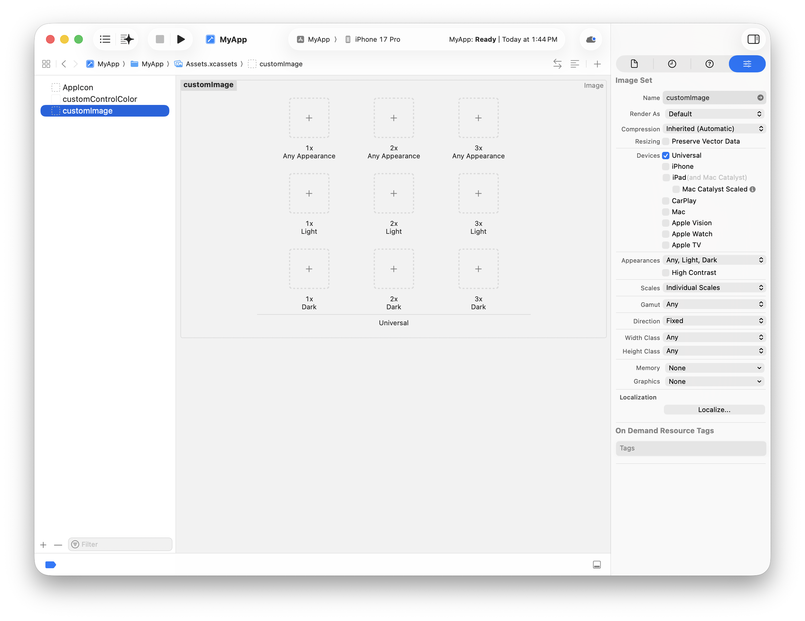
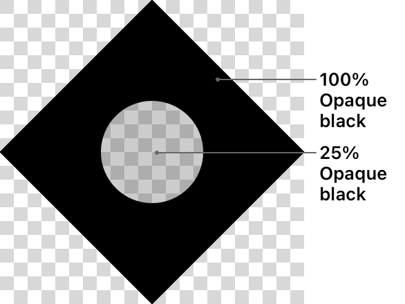
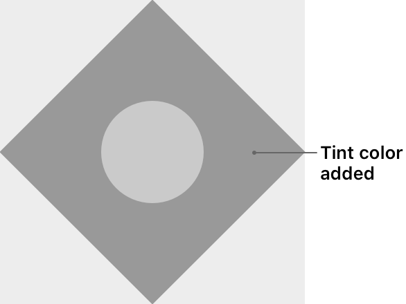
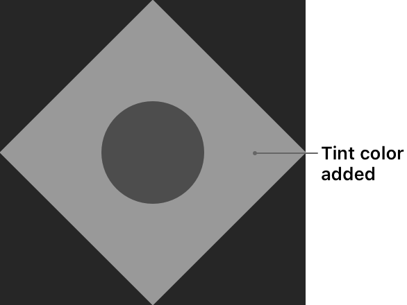

> 导航： [Technologies](../technologies.md) · [UIKit](../uikit.md) · [Appearance customization](appearance-customization.md) · [Supporting Dark Mode in your interface](supporting-dark-mode-in-your-interface.md)

# 为不同外观提供图像

文章

提供适用于浅色与深色外观以及高对比度环境的图像资源。

## 概述

无论 App 界面在何处使用位图图像，都要确保这些图像在浅色与深色外观下看起来都很好。在一种外观下看起来不错的位图图像，在另一种外观下可能显得褪色或难以看清。幸运的是，资源目录简化了为每种外观样式管理图像资源以及在适当时显示正确图像的过程。

创建位图图像的另一种方式是改用模板图像或符号图像。模板图像指定你想要绘制的形状，但不包含关联的颜色信息。符号图像与模板图像类似，但基于矢量，因此可以缩放到不同大小。两种图像类型都简化了对深色模式的支持。它们还减少了你必须随 App 一起发布的图像资源数量。

### 为不同外观自定图像资源

管理不同外观图像的最佳方式是使用资源目录。资源目录中的每个资源都表示一个你从 App 加载的命名图像。该资源内部包含同一图像的多个变体，每个变体都具有适合浅色、深色与高对比度环境的适当内容与颜色。当你加载一个资源时，你会获得对整个资源及其所有图像变体的引用。在绘制期间，系统会根据当前设置自动绘制适当的变体。当设置更改时，系统会使用新设置重绘图像。

在 Xcode 中创建图像资源，并使用 Appearance 属性配置你想要提供的变体。

Xcode 界面的图像，用于配置图像资源。在从属性检查器配置外观选项后，将每个图像变体拖到编辑器窗口中的适当槽位。

你可以为以下特性的不同组合提供图像资源：

- 屏幕分辨率。为普通与 Retina 显示器提供图像。系统会选取最匹配当前屏幕分辨率的图像。
- 浅色与深色外观。为浅色与深色外观都提供图像。使用 Any Appearance 槽位以支持旧版本的 macOS 或 iOS。
- 高对比度。提供相邻颜色之间视觉分离度更高的图像。此类图像使视力障碍的人更容易看清图像细节。

### 使用符号图像创建可缩放与可着色的图像

在 iOS、tvOS 与 watchOS 中，在通常会组合图像与文本形成图标的场合使用符号图像。符号图像是基于矢量的图像，用于你想显示简单形状或字形的场合。例如，在栏按钮项目中，或在你想将图标与描述组合的场合使用符号图像。符号图像有若干优势：

- 它们缩放时不会丢失任何清晰度。
- 你可以用适当的颜色对它们着色。
- 它们包含用于与文本布局的基线。
- 你可以用字体相关的样式信息配置它们，使它们看起来像是属于该字体。

系统提供了一个供你使用的图像库，你还可以为 App 所需的任何自定图标创建新的符号图像。有关如何创建与使用符号图像的信息，请参阅 [Configuring and displaying symbol images in your UI](configuring-and-displaying-symbol-images-in-your-ui.md)。

### 使用模板图像创建可着色的图像

为不同外观提供不同图像的另一种方式是提供一个适用于所有外观的单个模板图像。模板图像是位图图像，其中只有图像的不透明度起作用。通常，你使用模板图像表示图标形状。例如，你可能会使用模板图像表示媒体 App 的播放与暂停按钮。

当你将模板图像添加到按钮或图像视图时，你还要指定一种着色颜色。视图会将着色颜色应用于每个 alpha 不为 `0.0` 的像素，使图像的形状采用该颜色。要支持不同外观，只需更改着色颜色。例如，你可能在浅色环境中应用深色着色颜色，在深色环境中应用浅色着色颜色。

一个带有透明背景、100% 不透明的黑色菱形形状以及菱形内部 25% 不透明黑色圆形形状的模板图像。

使用你喜欢的图像编辑器创建模板图像文件。创建图像时，使用透明背景，并在你希望图像出现的位置添加黑色像素。像素可以完全或部分不透明，具体取决于你希望模板图像的哪些部分与背景颜色混合。将图像添加到资源目录时，在检查器中将 Image Set 资源的 Render As 选项设置为 Template Image。

### 在 macOS 中使用绘制处理器创建图像

在设计 App 界面时，你通常在设计时创建图像并将其包含在随 App 发布的 bundle 中。然而，在 macOS 中，你还可以动态创建图像，这在你还不知道图像内容是什么，或内容可更改时会这样做。

要创建一个动态绘制其内容的图像，使用 [init(size:flipped:drawingHandler:)](<../appkit/nsimage/init(size_flipped_drawinghandler_).md>) 方法，用自定绘制处理器 block 初始化你的图像。当系统外观更改时，AppKit 会调用你的处理器 block，给你机会使用新外观重绘图像。

## 另请参阅

### 图像

- [Configuring and displaying symbol images in your UI](configuring-and-displaying-symbol-images-in-your-ui.md) — 创建可与 App 文本集成的可缩放图像，并动态调整这些图像的外观。
