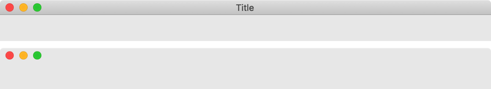

> 导航：[Technologies](../technologies.md) · [UIKit](../uikit.md) · [Mac Catalyst](mac-catalyst.md)

# 移除使用 Mac Catalyst 构建的 Mac App 中的标题栏

<sub>文章</sub>

通过移除标题栏，显示充满窗口整个高度的内容。

## 概述

默认情况下，使用 Mac Catalyst 构建的 Mac App 会在窗口顶部显示标题栏。一条水平线将标题栏与窗口内容分隔开。

某些 Mac App（如「信息」和「通讯录」）的主窗口没有标题栏。相反，窗口顶部仅显示关闭、最小化和缩放按钮，并且这些按钮与窗口内容之间没有分隔线。在这种 UI 设计中，内容区域充满窗口的整个高度。

下图在两个窗口中展示了这些样式。第一个窗口显示标题栏，第二个窗口没有。



### 移除标题栏

如果你选择设计一个没有标题栏的窗口，就必须从窗口中移除它。要移除标题栏，将标题栏的 [titleVisibility](uititlebar/titlevisibility.md) 属性设为 [UITitlebarTitleVisibilityHidden](uititlebartitlevisibility/hidden.md)，并将 [toolbar](uititlebar/toolbar.md) 属性设为 `nil`。以下代码展示了在设置新场景期间如何从窗口移除标题栏及其分隔线。

```swift
func scene(_ scene: UIScene, willConnectTo session: UISceneSession, options connectionOptions: UIScene.ConnectionOptions) {
    
    guard let windowScene = (scene as? UIWindowScene) else { return }
    
    #if targetEnvironment(macCatalyst)
    if let titlebar = windowScene.titlebar {
        titlebar.titleVisibility = .hidden
        titlebar.toolbar = nil
    }
    #endif

}
```

## 另请参阅

### 用户界面

- [UIKit Catalog: Creating and customizing views and controls](uikit-catalog-creating-and-customizing-views-and-controls.md) — 使用视图和控制自定 App 的用户界面。
- [Building and improving your app with Mac Catalyst](building-and-improving-your-app-with-mac-catalyst.md) — 通过支持原生控制、多窗口、共享、打印、菜单和键盘快捷键改进你的 iPadOS App 的 Mac Catalyst 版本。
- [Displaying a checkbox in your Mac app built with Mac Catalyst](displaying-a-checkbox-in-your-mac-app-built-with-mac-catalyst.md) — 当 App 在 Mac 用户界面习惯用法下运行时，将切换控制呈现为 Mac 风格的复选框。
- [Toolbar](toolbar.md) — 在窗口的标题栏下方、自定内容上方提供控制的空间。
- [Touch Bar](../appkit/touch-bar.md) — 在 Touch Bar 中显示交互式内容和控制。
