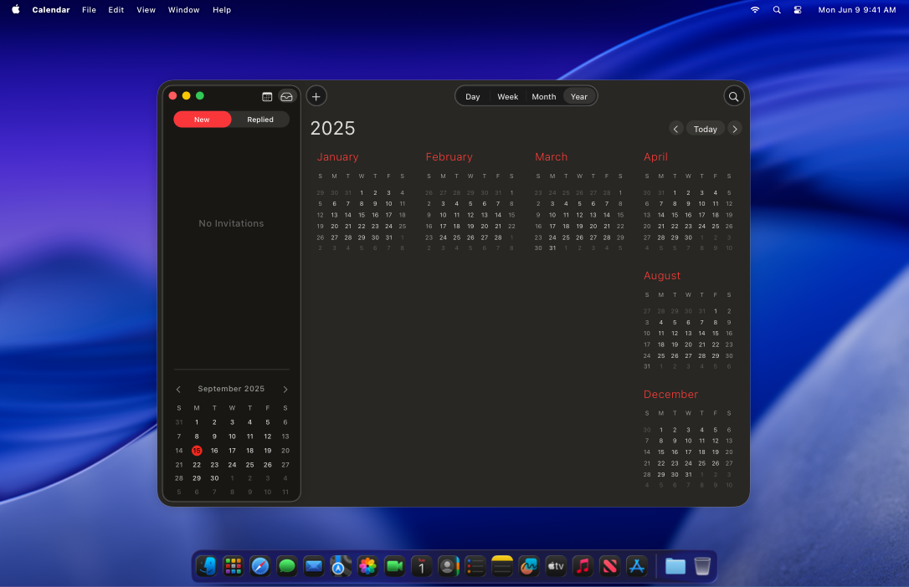
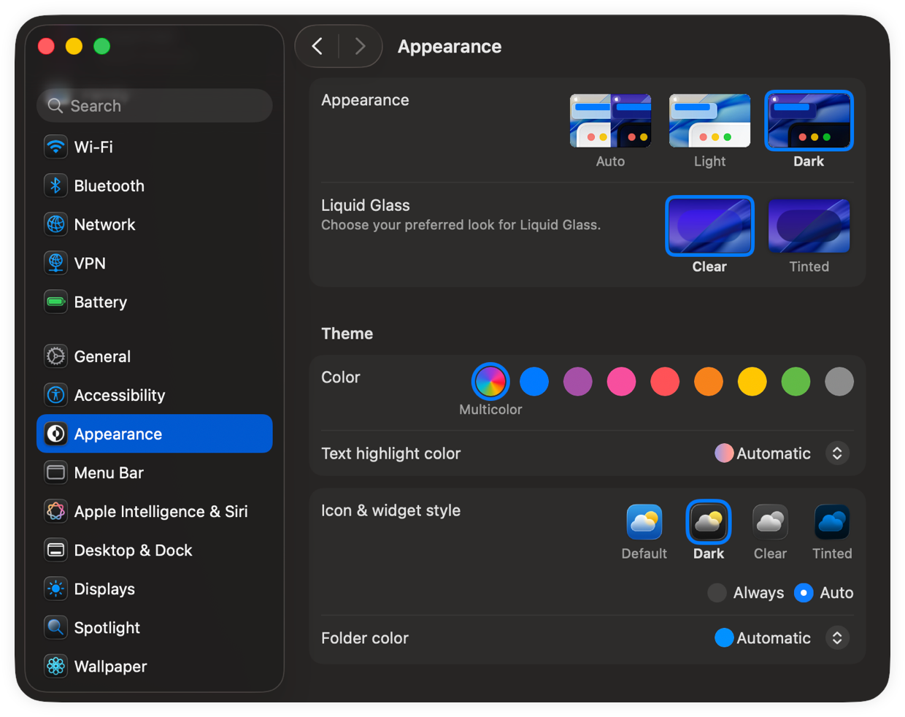
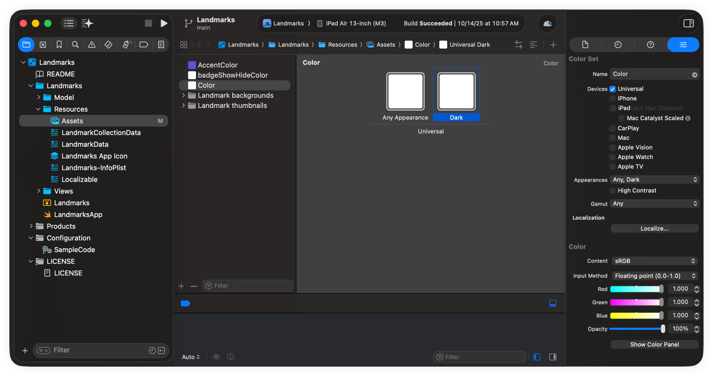

> 导航：[技术](../technologies.md) · [UIKit](../uikit.md) · [外观自定](appearance-customization.md)

# 在界面中支持深色模式

更新颜色、图像和行为，让 App 在深色模式激活时自动适应。

## 概述

在 macOS 和 iOS 上，用户可以选择采用系统范围的浅色或深色外观。深色外观即深色模式（Dark Mode），它实现了一种许多 App 已经采用的界面风格。用户会选择自己偏好的美学风格，还可以选择根据环境光照条件或特定的时间表来切换界面。



所有 App 都应同时支持浅色和深色界面风格，但在某些地方使用特定外观可能有更好的表现。例如，对于打印内容，你可能始终采用浅色外观。

在更改代码之前，先开启深色模式，看看你的 App 会如何响应。系统已经为你做了大量工作；如果你的 App 使用标准视图和控制，你可能不需要做太多更改。标准视图和控制会自动更新其外观以匹配当前的界面风格。如果你已经在使用颜色和图像资源，可以在不更改代码的情况下添加深色变体。



### 为你的 UI 选择自适应颜色

选择能自动适应底层界面风格的颜色。浅色和深色界面使用的调色板差别很大。在浅色外观下表现良好的颜色，在深色外观下可能很难看清，反之亦然。自适应颜色对象会针对不同的界面风格返回不同的颜色值。

创建自适应颜色对象有两种方式：

- 选择语义化颜色而非固定的颜色值。配置 UI 元素时，选择名称类似 [labelColor](../appkit/nscolor/labelcolor.md) 的颜色。这些语义化颜色传达颜色的预期用途，而不是具体的颜色值。当你把它们用于预期目的时，它们会以适合当前设置的颜色值渲染。完整的语义化颜色名称列表请参阅 [NSColor](../appkit/nscolor.md) 和 [UIColor](uicolor.md)。
- 在资源目录中定义自定颜色。当需要特定颜色时，将其创建为颜色资源。在你的资源中，为浅色和深色外观分别指定不同的颜色值。你还可以为颜色指定高对比度版本。

你使用 Xcode 的资源编辑器配置自定颜色资源。向项目添加一个 Color Set 资源，并配置你想修改的外观变体。使用 Any Appearance（任意外观）变体来指定在不支持深色模式的旧系统上使用的颜色值。



要从资源目录加载颜色值，请按名称加载颜色：

```swift
// macOS
let aColor = NSColor(named: NSColor.Name("customControlColor"))

// iOS
let aColor = UIColor(named: "customControlColor")
```

当你从颜色资源创建颜色对象后，当前外观变化时无需重新创建该对象。每次为绘图设置填充色或描边色时，颜色对象都会加载与当前环境设置相匹配的颜色变体。对于 [labelColor](../appkit/nscolor/labelcolor.md) 这类语义化颜色也是如此，它们会自动适应当前环境。相比之下，使用固定分量值创建的颜色对象不会自适应；你必须改为创建新的颜色对象。

> [!note] 注意
> 对于用户的内容，请始终保留用户显式选择的颜色。例如，绘画 App 不应试图更改用户应用到画布上的颜色。自适应颜色主要用在 App 界面边饰（chrome）的视图和控制中。

### 为所有外观创建图像

确保界面中的图像在浅色和深色外观下都好看。界面在很多地方使用图像，包括按钮、图像视图以及自定视图和控制。如果某张图像在切换外观时很难看清，请提供一张在另一种外观下好看的新图像资源。更好的做法是使用符号图像或模板图像，它们只定义要渲染的形状，因此不需要为浅色、深色和高对比度环境分别准备单独的图像。

有关为浅色和深色界面配置图像的信息，请参阅[为不同外观提供图像](providing-images-for-different-appearances.md)。

### 使用特定方法更新自定视图

当用户更改系统外观时，系统会自动要求每个窗口和视图重绘自己。在此过程中，系统会为 macOS 和 iOS 调用下表列出的几个众所周知的方法，以更新你的内容。系统会在调用这些方法之前更新特性环境，因此如果你把所有对外观敏感的更改都放在这些方法中，你的 App 就会正确地自我更新。

| 类 | 适用的方法 |
|---|---|
| [NSView](../appkit/nsview.md) | [updateLayer()](<../appkit/nsview/updatelayer().md>)  [draw(_:)](<../appkit/nsview/draw(__).md>)  [layout()](<../appkit/nsview/layout().md>)  [updateConstraints()](<../appkit/nsview/updateconstraints().md>) |
| [UIView](uiview.md) | [- traitCollectionDidChange:](<uitraitenvironment/traitcollectiondidchange(__).md>)  [- layoutSubviews](<uiview/layoutsubviews().md>)  [- drawRect:](<uiview/draw(__).md>)  [- updateConstraints](<uiview/updateconstraints().md>)  [- tintColorDidChange](<uiview/tintcolordidchange().md>) |
| [UIViewController](uiviewcontroller.md) | [- traitCollectionDidChange:](<uitraitenvironment/traitcollectiondidchange(__).md>)  [- updateViewConstraints](<uiviewcontroller/updateviewconstraints().md>)  [- viewWillLayoutSubviews](<uiviewcontroller/viewwilllayoutsubviews().md>)  [- viewDidLayoutSubviews](<uiviewcontroller/viewdidlayoutsubviews().md>) |
| [UIPresentationController](uipresentationcontroller.md) | [- traitCollectionDidChange:](<uitraitenvironment/traitcollectiondidchange(__).md>)  [- containerViewWillLayoutSubviews](<uipresentationcontroller/containerviewwilllayoutsubviews().md>)  [- containerViewDidLayoutSubviews](<uipresentationcontroller/containerviewdidlayoutsubviews().md>) |

如果你在这些方法之外进行对外观敏感的更改，你的 App 可能无法针对当前环境正确绘制内容。解决办法是把代码移到这些方法中。例如，不要在创建时设置 [NSView](../appkit/nsview.md) 对象图层的背景色，而是把那段代码移到视图的 [updateLayer()](<../appkit/nsview/updatelayer().md>) 方法中，如下面的代码示例所示。在创建时设置背景色看似合适，但由于 [CGColor](../coregraphics/cgcolor.md) 对象不会自适应，在创建时设置会让视图保留一个永不改变的固定背景色。把代码移到 [updateLayer()](<../appkit/nsview/updatelayer().md>) 中，每当环境变化时就会刷新背景色。

```swift
override func updateLayer() {
   self.layer?.backgroundColor = NSColor.textBackgroundColor.cgColor

   // 其他更新。
}
```

如果你的 App 中的代码不属于任何 [NSView](../appkit/nsview.md)，且无法使用上面列出的首选方法，它可以观察 App 的 [effectiveAppearance](../appkit/nsapplication/effectiveappearance.md) 属性，并手动更新 [current](../appkit/nsappearance/current.md)。

```swift
// 使用一个属性保持对键值观察对象的引用。
var observation: NSKeyValueObservation?

func applicationDidFinishLaunching(_ aNotification: Notification) {
    observation = NSApp.observe(\.effectiveAppearance) { (app, _) in
        app.effectiveAppearance.performAsCurrentDrawingAppearance {
            // 调用你的非视图代码，这些代码需要感知
            // 外观的变化。
        }
    }
}

```

### 根据预期用途选择视觉效果材质

视觉效果视图为你的背景视图添加透明度，与不透明的背景相比，这让你的 UI 更有视觉纵深感。为确保你的内容保持可见，视觉效果视图会轻微模糊背景内容，并添加虚化效果来自动调整前景内容的颜色。系统会动态更新这些效果，确保在底层内容变化时你的 App 内容保持可见。

在界面中将视觉效果视图用作容器视图，并向它们添加子视图来表示你的前景内容。根据你想要的外观，为每个视觉效果视图配置合适的材质或效果：

- 在 macOS 上，根据你在界面中使用该视图的方式，为 [NSVisualEffectView](../appkit/nsvisualeffectview.md) 配置合适的材质。例如，当把视觉效果视图用作边栏界面的背景时，为其配置 [NSVisualEffectView.Material.sidebar](../appkit/nsvisualeffectview/material-swift.enum/sidebar.md) 材质。
- 在 iOS 上，为 [UIVisualEffectView](uivisualeffectview.md) 配置特定的虚化和模糊效果，以营造你想要的外观。模糊效果定义背景视图的表观厚度，虚化效果则针对特定类型的内容调整外观，以确保它们保持可见。例如，当你的视图包含标签时，选择 [UIVibrancyEffectStyleLabel](uivibrancyeffectstyle/label.md) 样式或其他与标签相关的虚化选项。

> [!important] 重要
> 在 macOS 10.14 及更高版本中，不要使用已废弃的材质（例如 [NSVisualEffectView.Material.light](../appkit/nsvisualeffectview/material-swift.enum/light.md)），因为这些材质不能适应深色模式。请改为选择能正确适应环境的新材质。

### 仅在必要时选择退出

尽一切努力让你的 App 同时采用浅色和深色外观。如果支持某种外观对你的 App 的全部或部分来说没有意义，你可以在相应的窗口或视图中选择退出外观更改。例如，你的 App 的打印视图可能始终使用浅色外观。

你可以将界面的全部或部分配置为选择退出特定外观。你也可以让整个 App 采用特定外观。更多信息，请参阅以下内容：

- [Choosing a Specific Appearance for Your macOS App](../appkit/choosing-a-specific-appearance-for-your-macos-app.md)
- [Choosing a specific interface style for your iOS app](choosing-a-specific-interface-style-for-your-ios-app.md)

### 避免在外观过渡期间执行开销大的任务

当用户在浅色和深色界面之间切换时，系统会让你的 App 重绘其所有内容。尽管系统管理着绘制过程，但在该过程中的几个节点上它依赖你的自定代码。你的代码必须尽可能快，并且不执行与外观更改无关的任务。在 macOS 上，AppKit 通常会在外观更改期间创建过渡动画，但如果你的 App 重绘耗时过长，它会中止这些动画。

## 主题

### 外观支持

- [Choosing a Specific Appearance for Your macOS App](../appkit/choosing-a-specific-appearance-for-your-macos-app.md) — 当不适合同时支持浅色和深色变体时，为你的窗口、视图或 App 采用特定外观。
- [Choosing a specific interface style for your iOS app](choosing-a-specific-interface-style-for-your-ios-app.md) — 当不适合同时支持浅色和深色变体时，为你的视图、视图控制器或 App 采用特定界面风格。

### 图像

- [为不同外观提供图像](providing-images-for-different-appearances.md) — 提供适合浅色和深色外观以及高对比度环境的图像资源。
- [在 UI 中配置和显示符号图像](configuring-and-displaying-symbol-images-in-your-ui.md) — 创建可与 App 文本融合的可缩放图像，并动态调整这些图像的外观。

## 另请参阅

### 深色模式

- [采用 iOS 深色模式](adopting-ios-dark-mode.md) — 使用动态颜色和视觉效果在你的 iOS App 中采用深色模式。
