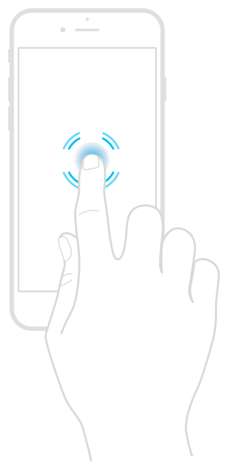

> 导航：[Technologies](../technologies.md) · [UIKit](../uikit.md) · [Touches, presses, and gestures](touches-presses-and-gestures.md)

# 跟踪 3D Touch 事件的力度

基于触摸的力度操控内容。

## 概述

屏幕上的触摸主要传达该触摸的位置。然而，支持 3D Touch 的设备还会报告用户手指按压屏幕的力度大小。（类似地，Apple Pencil 也会将其笔尖的力度大小报告给连接的设备。）你可以将触摸位置和力度值都用作 App 的输入。例如，绘图 App 可能使用力度来设置当前线条的粗细。

展示 3D Touch 设备如何检测触摸力度的图示。一个手指按压在显示屏上，向外辐射的圆环表示力度触摸。

与触摸关联的原始力度值可在 [UITouch](uitouch.md) 对象的 [force](uitouch/force.md) 属性中获取。你可以将该值与 [maximumPossibleForce](uitouch/maximumpossibleforce.md) 属性中的值进行比较，以确定相对的力度大小。

> [!important] 重要
> 如果你的 App 实现了轻按预览与弹出（peek-and-pop）支持，请不要使用原始力度作为 App 的输入。有关使用 3D Touch 支持 UIKit 轻按预览与弹出 API 的信息，请参阅 [Adopting 3D Touch on iPhone](https://developer.apple.com/library/archive/documentation/UserExperience/Conceptual/Adopting3DTouchOniPhone/index.html#//apple_ref/doc/uid/TP40016543)。

有关使用 3D Touch 的指南，请参阅 [iOS Human Interface Guidelines](https://developer.apple.com/ios/human-interface-guidelines/)。

## 主题

### 相关文章

- [Checking the availability of 3D Touch](checking-the-availability-of-3d-touch.md) — 在启用使用 3D Touch 的功能之前，检查设备是否支持 3D Touch。

## 另请参阅

### 触摸

- [Handling touches in your view](handling-touches-in-your-view.md) — 当触摸处理与视图内容紧密相关时，直接在视图子类中使用触摸事件。
- [Handling input from Apple Pencil](handling-input-from-apple-pencil.md) — 了解如何检测并响应来自 Apple Pencil 的触摸。
- [Illustrating the force, altitude, and azimuth properties of touch input](illustrating-the-force-altitude-and-azimuth-properties-of-touch-input.md) — 在视图中捕获 Apple Pencil 和触摸输入。
- [Leveraging touch input for drawing apps](leveraging-touch-input-for-drawing-apps.md) — 将触摸捕获为一系列笔触，并在绘图画布上高效渲染。
- [UITouch](uitouch.md) — 表示屏幕上发生触摸的位置、大小、移动和力度的对象。
