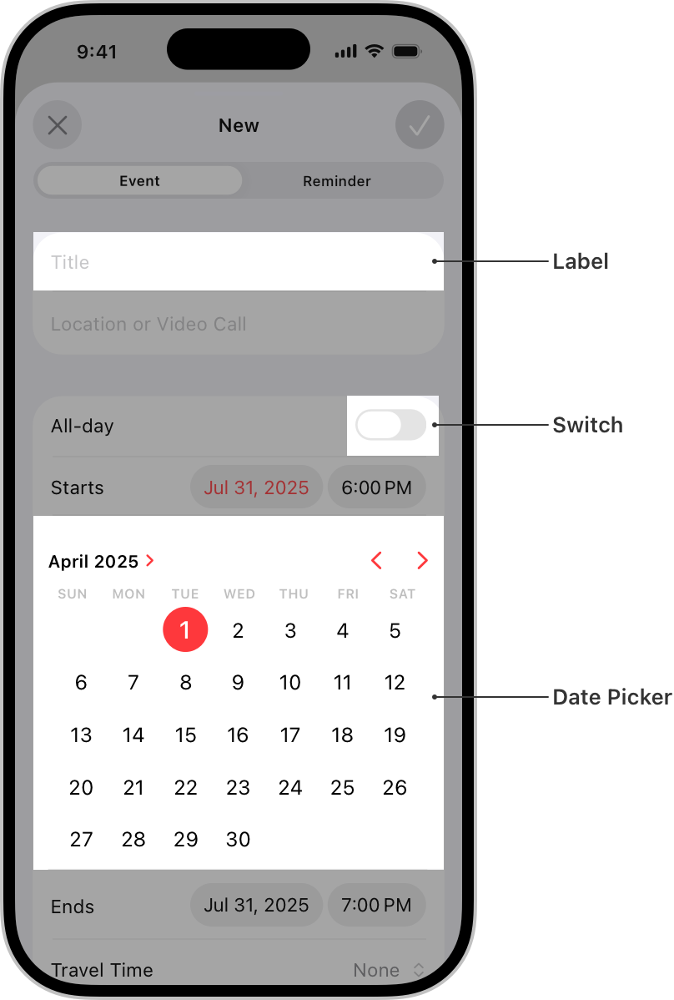

> 导航： [Technologies](../technologies.md) · [UIKit](../uikit.md)

# 视图与控件

API 集合

在屏幕上呈现你的内容，并定义与该内容允许的交互。

## 概述

视图与控件是你的 App 用户界面的可视化构建块。使用它们在屏幕上绘制和组织 App 的内容。

视图可以托管其他视图。将一个视图嵌入另一个视图中，会在宿主视图（称为 _superview_）和嵌入的视图（称为 _subview_）之间创建包含关系。视图层级结构使得管理视图更加容易。

你还可以使用视图执行以下任何操作：

- 响应触摸和其他事件（直接响应，或与手势识别器协调响应）。
- 使用 Core Graphics 或 UIKit 类绘制自定义内容。
- 支持拖放交互。
- 响应焦点更改。
- 对视图的大小、位置和外观属性进行动画。

[UIView](uiview.md) 是所有视图的根类，并定义它们的通用行为。[UIControl](uicontrol.md) 定义了特定于按钮、开关和其他为用户交互设计的视图的附加行为。

有关如何使用视图与控件的更多信息，参见 [Human Interface Guidelines](https://developer.apple.com/design/human-interface-guidelines/components/all-components)。要查看 UIKit 控件的示例，参见 [UIKit Catalog: Creating and customizing views and controls](uikit-catalog-creating-and-customizing-views-and-controls.md)。

## 主题

### View fundamentals

- [UIView](uiview.md) — 管理屏幕上矩形区域内容的对象。
- [UIKit Catalog: Creating and customizing views and controls](uikit-catalog-creating-and-customizing-views-and-controls.md) — 使用视图与控件自定义你的 App 用户界面。

### Container views

- [Autosizing views for localization in iOS](../xcode/autosizing-views-for-localization-in-ios.md) — 向你的 App 添加 Auto Layout 约束，以实现可本地化的视图。
- [Collection views](collection-views.md) — 使用可配置且高度可自定义的布局显示嵌套视图。
- [Table views](table-views.md) — 在可自定义行的单列中显示数据。
- [UIStackView](uistackview.md) — 用于在列或行中布局一组视图的精简界面。
- [UIScrollView](uiscrollview.md) — 允许滚动和缩放其包含视图的视图。
- [UILookToScrollInteraction](uilooktoscrollinteraction.md) _(beta)_

### Content views

- [UIActivityIndicatorView](uiactivityindicatorview.md) — 显示任务正在进行的视图。
- [UICalendarView](uicalendarview.md) — 显示带有日期特定装饰的日历的视图，并提供选择单个或多个日期的功能。
- [UIContentUnavailableView](uicontentunavailableview.md) — 指示没有内容可显示的视图。
- [UIImageView](uiimageview.md) — 在你的界面中显示单个图像或动画图像序列的视图。
- [UIPickerView](uipickerview.md) — 使用旋转轮或老虎机比喻显示一组或多组值的视图。
- [UIProgressView](uiprogressview.md) — 随时间描绘任务进度的视图。

### Controls

- [Responding to control-based events using target-action](responding-to-control-based-events-using-target-action.md) — 通过使用目标-动作设计模式将按钮、滑块和其他控件连接到你的 App 代码，处理用户输入。
- [UIControl](uicontrol.md) — 控件的基类，控件是传达特定操作或意图以响应用户交互的可视化元素。
- [UIButton](uibutton.md) — 响应用户交互执行你的自定义代码的控件。
- [UIColorWell](uicolorwell.md) — 显示颜色选择器的控件。
- [UIDatePicker](uidatepicker.md) — 用于输入日期和时间值的控件。
- [UIPageControl](uipagecontrol.md) — 显示水平点序列的控件，每个点对应于 App 文稿或其他数据模型实体中的一个页面。
- [UISegmentedControl](uisegmentedcontrol.md) — 由多个分段组成的水平控件，每个分段都作为离散按钮发挥作用。
- [UISlider](uislider.md) — 用于从连续值范围中选择单个值的控件。
- [UIStepper](uistepper.md) — 用于递增或递减值的控件。
- [UISwitch](uiswitch.md) — 提供二元选择（如开/关）的控件。

### Text views

- [UILabel](uilabel.md) — 显示一行或多行信息文本的视图。
- [UITextField](uitextfield.md) — 在你的界面中显示可编辑文本区域的对象。
- [UITextView](uitextview.md) — 可滚动的多行文本区域。
- [Drag and drop customization](drag-and-drop-customization.md) — 扩展文本视图的标准拖放支持，以包含自定义类型的内容。

### Search field

- [UISearchTextField](uisearchtextfield.md) — 用于显示和编辑文本及搜索标记的视图。
- [UISearchToken](uisearchtoken.md) — 搜索文本栏中的搜索条件，由文本和可选图标表示。
- [UISearchTextFieldDelegate](uisearchtextfielddelegate.md) — 搜索栏 delegate 的接口。

### Visual effects

- [UIVisualEffect](uivisualeffect.md) — 视觉效果视图以及模糊和虚化效果对象的初始化器。
- [UIVisualEffectView](uivisualeffectview.md) — 实现某些复杂视觉效果的对象。
- [UIVibrancyEffect](uivibrancyeffect.md) — 放大并调整视觉效果视图后面图层内容颜色的对象。
- [UIBlurEffect](uiblureffect.md) — 对视觉效果视图后面图层内容应用模糊效果的对象。
- [UIColorEffect](uicoloreffect.md) — 应用纯色背景的视觉效果。

### Bars

- [UIBarItem](uibaritem.md) — 你可以添加到屏幕底部栏中的项的抽象超类。
- [UIBarButtonItem](uibarbuttonitem.md) — 用于放置在工具栏、导航栏或快捷键栏上的专用按钮。
- [UIBarButtonItemGroup](uibarbuttonitemgroup.md) — 用于放置在导航栏或快捷键栏上的一个或多个栏按钮项的组。
- [UIBarButtonItemVisibilityPriority](uibarbuttonitemvisibilitypriority.md) _(beta)_
- [UINavigationBar](uinavigationbar.md) — 显示在屏幕顶部栏中的导航控件，通常与导航控制器配合使用。
- [UISearchBar](uisearchbar.md) — 用于从用户接收搜索相关信息的专用视图。
- [UIToolbar](uitoolbar.md) — 在你的界面边缘显示一个或多个按钮的控件。
- [UITabBar](uitabbar.md) — 在标签页栏中显示一个或多个按钮的控件，用于在 App 中的不同子任务、视图或模式之间选择。
- [UITabBarItem](uitabbaritem.md) — 描述标签页栏中项的对象。
- [UIBarPositioning](uibarpositioning.md) — 用于定义 iOS App 中栏定位的一组方法。
- [UIBarPositioningDelegate](uibarpositioningdelegate.md) — 支持符合 [UIBarPositioning](uibarpositioning.md) 协议的栏定位的一组方法。
- [UIBarMinimization](uibarminimization-swift.struct.md)

### Content viewer

- [UILargeContentViewerInteraction](uilargecontentviewerinteraction.md) — 一种交互，当支持最大的动态字体大小不合适时，启用手势以呈现大内容查看器。
- [UILargeContentViewerInteractionDelegate](uilargecontentviewerinteractiondelegate.md) — 自定义大内容查看器交互行为的对象。
- [UILargeContentViewerItem](uilargecontentvieweritem.md) — 提供关于如何在大内容查看器中显示自定义内容的详细信息的方法。

### Private Click Measurement (PCM)

- [UIEventAttributionView](uieventattributionview.md) — 用于验证 Web AdAttributionKit 用户交互的覆盖视图。
- [UIEventAttribution](uieventattribution.md) — 包含 Web AdAttributionKit 事件归因信息的对象。
- [NSAdvertisingAttributionReportEndpoint](../bundleresources/information-property-list/nsadvertisingattributionreportendpoint.md) — Private Click Measurement 和 SKAdNetwork 发送归因信息的 URL。

### SwiftUI

- [Using SwiftUI with UIKit](using-swiftui-with-uikit.md) — 了解如何将 SwiftUI 视图融入 UIKit App。

### Related types

- [UIOffset](uioffset.md) — 指定偏移位置数量的结构。
- [UIAxis](uiaxis.md) — 指定布局轴的结构。
- [UIEdgeInsets](uiedgeinsets.md) — 视图的内边距距离。
- [NSDirectionalEdgeInsets](nsdirectionaledgeinsets.md) — 考虑用户界面布局方向的视图内边距距离。
- [NSDirectionalRectEdge](nsdirectionalrectedge.md) — 考虑用户界面布局方向的边缘或一组边缘的常量。
- [NSRectAlignment](nsrectalignment.md) — 根据用户界面布局方向指定与边缘或一组边缘对齐的常量。
- [UIKit macros](uikit-macros.md) — UIKit 定义的宏。

## 另请参阅

### User interface

- [View controllers](view-controllers.md) — 使用视图控制器管理你的界面，并促进围绕 App 内容的导航。
- [View layout](view-layout.md) — 使用叠放视图自动布局界面的视图。需要精确放置视图时使用 Auto Layout。
- [Appearance customization](appearance-customization.md) — 将 Liquid Glass 应用于视图，支持 App 中的深色模式，自定义栏的外观，并使用外观代理修改 UI。
- [Animation and haptics](animation-and-haptics.md) — 使用基于视图的动画和触感反馈向用户提供反馈。
- [Windows and screens](windows-and-screens.md) — 为你的视图层级结构和其他内容提供容器。
