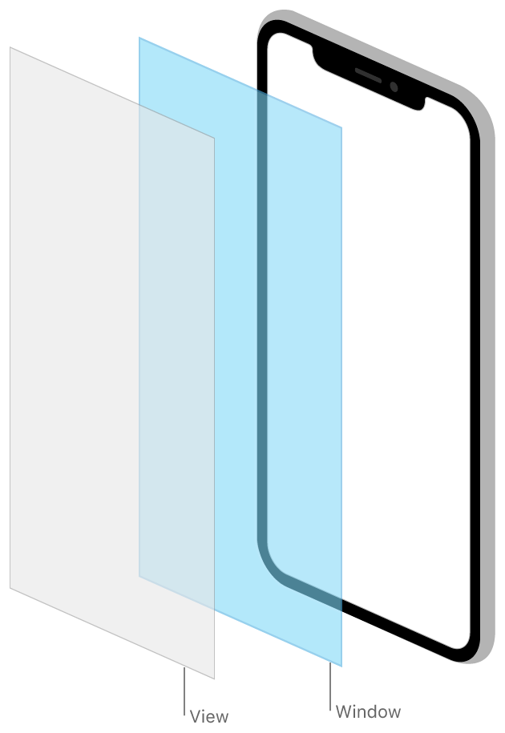

> 导航：[Technologies](../technologies.md) · [UIKit](../uikit.md)

# 窗口与屏幕

API 集合

为你的视图层级结构和其他内容提供容器。

## 概述

窗口对象是 App 屏幕内容的容器，屏幕则向 App 报告底层显示设备的特性。使用[场景](scenes.md)来配置和管理你的用户界面，并查看 [UIScreen](uiscreen.md) 对象以了解设备的主屏幕或连接的显示设备。

[UIWindow](uiwindow.md) 对象本身不提供任何可见内容。窗口的所有可见内容都由其根视图控制器提供，你在 App 的 storyboard 中配置该控制器。窗口的作用是接收来自 UIKit 的事件，并将任何相关事件转发给根视图控制器及关联的视图。UIKit 会为你提供一个初始窗口供使用，你也可以根据需要创建额外的窗口。

## 主题

### 窗口

- [UIWindow](uiwindow.md) — 你的 App 用户界面的背景，并将事件分发给视图的对象。
- [UICoordinateSpace](uicoordinatespace.md) — 一组在屏幕上不同坐标系之间转换的方法。

### 场景

- [场景](scenes.md) — 同时管理你的 App 用户界面的多个实例，并将资源导向 UI 的相应实例。

### 弹出窗口

- [在弹出窗口中显示临时内容](displaying-transient-content-in-a-popover.md) — 在 iPad 上于 App 内容之上显示临时界面。
- [UIPopoverPresentationController](uipopoverpresentationcontroller.md) — 管理弹出窗口中内容显示的对象。
- [UIPopoverBackgroundView](uipopoverbackgroundview.md) — 弹出窗口的背景外观。
- [UIPopoverBackgroundViewMethods](uipopoverbackgroundviewmethods.md) — 弹出窗口背景视图子类必须实现的一组方法。

### 提醒

- [使用提醒和操作表单引起用户注意](getting-the-user-s-attention-with-alerts-and-action-sheets.md) — 向用户呈现重要信息或就重要选择进行提示。
- [UIAlertController](uialertcontroller.md) — 显示提醒消息的对象。
- [UIAlertAction](uialertaction.md) — 用户点击提醒中的按钮时可执行的操作。

### 屏幕

- [在连接的显示设备上呈现内容](presenting-content-on-a-connected-display.md) — 为你的 App 在连接的显示设备上填充额外内容。
- [UIScreen](uiscreen.md) — 定义与基于硬件的显示设备相关属性的对象。
- [UIScreenMode](uiscreenmode.md) — 可应用于屏幕对象的一组可能属性。

## 另请参阅

### 用户界面

- [视图与控制](views-and-controls.md) — 在屏幕上呈现内容并定义与该内容允许的交互。
- [视图控制器](view-controllers.md) — 使用视图控制器管理界面，并在 App 内容间进行导览。
- [视图布局](view-layout.md) — 使用叠放视图自动布局界面视图。需要精确放置视图时使用 Auto Layout。
- [外观自定](appearance-customization.md) — 为视图应用 Liquid Glass，支持 App 中的深色模式，自定栏的外观，并使用外观代理修改 UI。
- [动画与触感反馈](animation-and-haptics.md) — 使用基于视图的动画和触感反馈向用户传递反馈。
